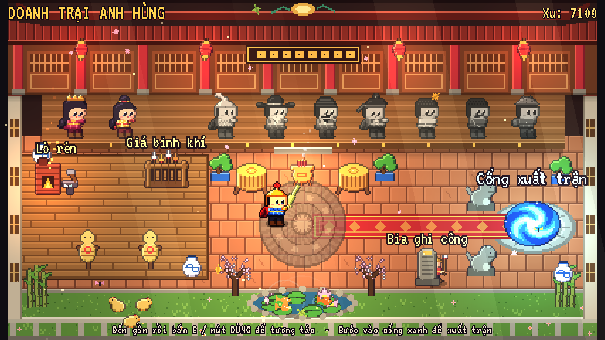
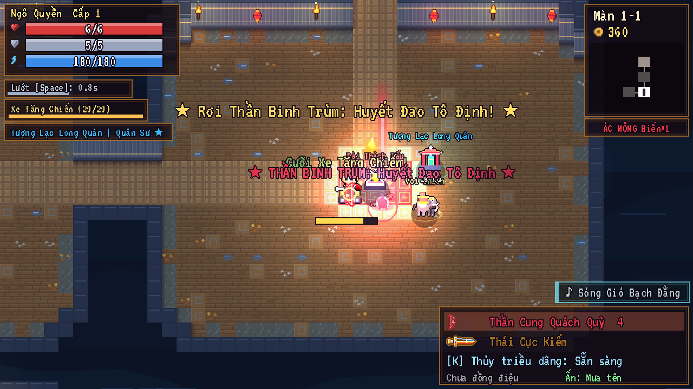
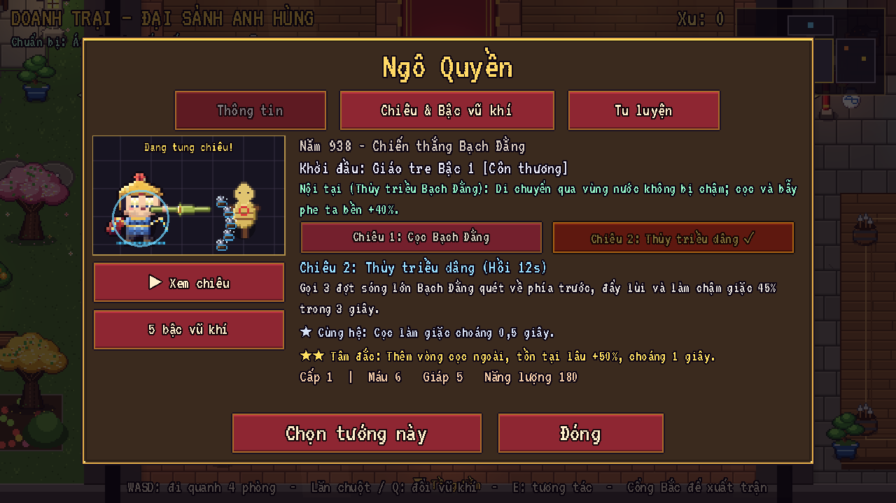
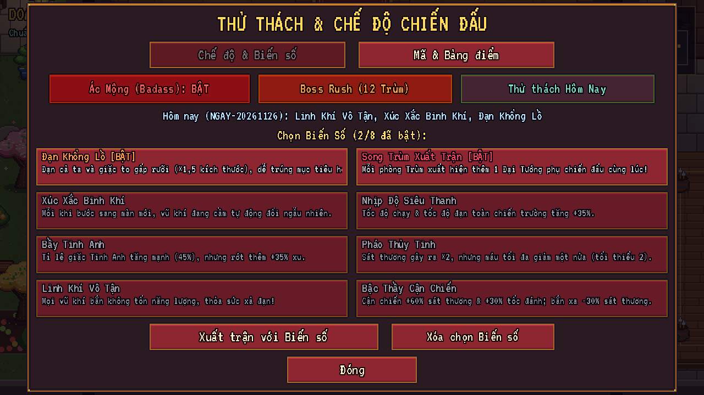
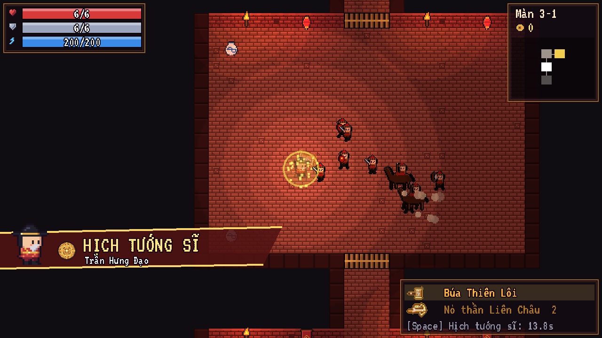

<div align="center">

# ⚔️ ANH HÙNG ĐẤT VIỆT ⚔️

### Phiên bản `v2.2.0` — *Tàng Kinh & Chia Binh*

*Game hành động Roguelike bắn quái góc nhìn từ trên xuống (Top-Down Bullet-Hell) lấy cảm hứng từ Soul Knight — Tái hiện hào khí 2.000 năm lịch sử & truyền thuyết Việt Nam bằng đồ họa Pixel Art.*

[](https://github.com/Anhle26-per/anh-hung-dat-viet/releases/latest)
[](https://godotengine.org/)
[](#%EF%B8%8F-217-binh-khí-hợp-nhất--13-thần-binh-đỏ)
[](#-11-danh-tướng--nội-tại-chiêu-1--chiêu-2)
[](#-tải-game--cài-đặt)

</div>

---

<div align="center">

| Doanh Trại Anh Hùng 4 Khu | Sự Kiện `[!]`, Xe Tăng & Thần Binh Đỏ |
| :---: | :---: |
|  |  |
| **Nội Tại Riêng & Chọn Chiêu 1 / Chiêu 2** | **Ác Mộng, Boss Rush & 8 Biến Số Chiến Trường** |
|  |  |

</div>

---

## 📦 Tải Game & Cài Đặt

Tất cả bản dựng chính thức được phát hành tại trang [**GitHub Releases**](https://github.com/Anhle26-per/anh-hung-dat-viet/releases/latest):

| Nền tảng | Tải trực tiếp | Cách chạy nhanh |
|---|---|---|
| **Windows (`.zip`)** | [**AnhHungDatViet-Windows.zip**](https://github.com/Anhle26-per/anh-hung-dat-viet/releases/latest/download/AnhHungDatViet-Windows.zip) | Giải nén toàn bộ thư mục và mở `AnhHungDatViet.exe` |
| **macOS Universal (`.dmg` / `.zip`)** | [**Xem tại Releases**](https://github.com/Anhle26-per/anh-hung-dat-viet/releases/latest) | Kéo vào *Applications* (xem thêm [Hướng dẫn cài chi tiết](docs/HUONG-DAN-CAI.md)) |
| **Android (`.apk`)** | [**AnhHungDatViet.apk**](https://github.com/Anhle26-per/anh-hung-dat-viet/releases/latest/download/AnhHungDatViet.apk) | Cài trực tiếp tệp `.apk` trên máy Android |
| **Gói cập nhật (`.pck`)** | [**AnhHungDatViet.pck**](https://github.com/Anhle26-per/anh-hung-dat-viet/releases/latest/download/AnhHungDatViet.pck) | Dùng cho tính năng tự động cập nhật trong game |

> 💡 **Tự Động Cập Nhật Ngay Trong Game (Hotpatch `patch.pck`)**  
> Từ các phiên bản `v1.2.9+`, khi mở game ở màn hình chính, hệ thống tự kiểm tra bản mới nhất trên GitHub và cho phép **bấm 1 nút để tải bản vá `.pck`**, áp dụng ngay không cần tải lại cả bộ cài và vẫn **giữ nguyên toàn bộ file lưu cũ** (tướng, xu, nguyên liệu, bản vẽ, thành tựu).

---

## 🔥 Điểm Nhấn Phiên Bản `v2.2.0 — Tàng Kinh & Chia Binh`

- **Vứt & Chia Sẻ Vũ Khí Trong LAN (`Phím G` / Nút `Vứt`)**: Khi cầm từ 2 vũ khí trở lên, bấm **`G`** (hoặc nút **Vứt** trên màn hình cảm ứng, `D-Pad Xuống` trên tay cầm) để thả vũ khí đang cầm xuống sàn chia sẻ cho đồng đội; cơ chế nhặt & đổi vũ khí đầy ô qua Chủ phòng đồng bộ chặt chẽ, chống nhặt trùng tuyệt đối.
- **Rương Chiến Lợi Phẩm Hậu Hĩnh Hơn (Ưu Tiên Cấp 3–5 & Nổ Hũ Thần Binh)**: Rương sơn mài có **35%** (`42%` ở Ác Mộng) rơi vũ khí theo trọng số ưu tiên **Cấp 3–5** (>45% rương thường, >75% rương báu) và cơ hội **nổ hũ Thần Binh Đỏ (`boss_motif`)**, tỏa cột sáng hào quang phân biệt bậc hiếm ngay trên sàn.
- **Mảnh Bản Vẽ & Ghép Bản Vẽ (`Bàn Bản Vẽ` & `Lò Rèn`)**: Để rèn binh khí tại Lò Rèn nay bắt buộc phải sở hữu **Bản vẽ**. Thu thập **Mảnh Bản Vẽ** riêng từng người chơi từ Rương ải (`35%` / `45%` Ác Mộng), Rương báu, Tinh nhuệ (`22%`), Tam Yêu (`65%` / `100%` Thần thoại) và Trùm (`100%`): Cấp 1–2 cần `1` mảnh, Cấp 3 cần `2`, Cấp 4 cần `3`, Cấp 5 thường cần `4`, Thần Binh Đỏ & Hợp nhất cần `5` mảnh — ghép ngay tại **Bàn Bản Vẽ** (kèm lọc tab **🧩 Mảnh ghép** và nút **Ghép tất cả**) hoặc trực tiếp trong **Lò Rèn**.
- **Nền Tảng `v2.1.0` & `v2.0.0`**: Giữ trọn **13 Đại Trùm 36 khung hành động**, **Vạn Binh Khởi Trận (`8–22` giặc/đợt)**, **LAN Lobby chung chọn trùng tướng**, **Linh Thú đồng hành từ Sảnh**, **11 Tướng • 22 Chiêu**, **217 Binh Khí**, **39 Phúc lành**, **6 Phòng `[!]`**, **3 Thú Cưỡi**, **Ác Mộng** & **Boss Rush 13 tầng**.

---

## 🎮 Bảng Điều Khiển

| Hành động | Máy tính (`PC`) | Điện thoại (`Touch`) | Tay cầm (`Gamepad`) |
|---|---|---|---|
| **Di chuyển** | `WASD` / Phím mũi tên | Cần gạt trái | Cần trái |
| **Tấn công / Tụ lực** | Giữ `Chuột trái` / `J` | Giữ nút Tấn công | `A` / Cò phải (`RT`) |
| **Ngắm bắn** | Theo trỏ chuột | Tự động ngắm | Tự động ngắm |
| **Tung Kỹ năng** | `Chuột phải` / `K` | Nút Kỹ năng | `B` |
| **Lướt né (i-frame)** | `Space` | Nút Lướt | `X` |
| **Chạy nhanh** | `Shift` | — | Nhấn cần trái (`L3`) / Cò trái (`LT`) |
| **Đổi vũ khí** | `Q` / Lăn chuột | Nút **Đổi** | `LB` |
| **Vứt vũ khí (chia sẻ LAN)** | `G` *(khi cầm ≥ 2 món)* | Nút **Vứt** | `D-Pad Xuống` |
| **Nhặt / Tương tác** | `E` | Nút **Nhặt / Dùng** | `Y` |
| **Hợp nhất vũ khí** | `R` *(khi đứng cạnh đồ ghép được)* | Nút **Hợp nhất** | `RB` |
| **Tạm dừng** | `Esc` / `P` | Nút `II` | `Start` |

> Mẹo thử giao diện cảm ứng trên PC: mở Godot vào *Debug → Customize Run Instances*, thêm `--touch` vào *Main Run Args*.

---

## 🦸 11 Danh Tướng — Nội Tại, Chiêu 1 & Chiêu 2

Mỗi danh tướng sở hữu bộ chỉ số riêng, **1 Nội tại đặc trưng** và **2 Kỹ năng chủ động** có thể chuyển đổi tự do ngay trong Doanh trại trước giờ xuất trận.

| Tướng | Thời kỳ | Vũ khí gốc | Nội tại | Chiêu 1 | Chiêu 2 | Mở khóa |
|---|---|---|---|---|---|---|
| **Hai Bà Trưng** | Năm 40 - Mê Linh | Kiếm đồng Mê Linh | *Uy danh Mê Linh* | **Song Trưng** | **Cờ lệnh Mê Linh** | Có sẵn |
| **Bà Triệu** | Năm 248 - Núi Nưa | Đoản đao | *Thiết giáp cự tượng* | **Voi chiến** | **Chiêng núi Nưa** | Có sẵn |
| **Ngô Quyền** | Năm 938 - Bạch Đằng | Giáo tre | *Thủy triều Bạch Đằng* | **Cọc Bạch Đằng** | **Thủy triều dâng** | Có sẵn |
| **Lý Thường Kiệt** | Năm 1077 - Như Nguyệt | Nỏ tay | *Thơ thần hộ quốc* | **Nam quốc sơn hà** | **Tường Như Nguyệt** | `200 xu` |
| **Trần Hưng Đạo** | Năm 1285 - Bình Nguyên | Gươm lệnh | *Hào khí Đông A* | **Hịch tướng sĩ** | **Hỏa công Bạch Đằng** | `300 xu` |
| **Lê Lợi** | Năm 1427 - Chi Lăng | Côn Lam Sơn | *Ánh gươm Thuận Thiên* | **Gươm Thuận Thiên** | **Kim Quy hộ giá** | `400 xu` |
| **Quang Trung** | Năm 1789 - Đống Đa | Ống lửa | *Hành quân thần tốc* | **Thần tốc** | **Hỏa hổ đại pháo** | `500 xu` |
| **Nguyễn Trung Trực** | Năm 1861 - Nhật Tảo | Dao rựa | *Lửa thiêu Nhật Tảo* | **Hỏa hồng Nhật Tảo** | **Nhật Tảo xung kích** | `600 xu` |
| **Hoàng Hoa Thám** | Năm 1890 - Yên Thế | Súng hỏa mai Yên Thế | *Bóng rừng Yên Thế* | **Hùm thiêng Yên Thế** | **Phục kích Yên Thế** | `700 xu` |
| **Chiến sĩ Điện Biên** | Năm 1954 - Điện Biên Phủ | Súng trường bộ binh | *Quyết chiến Điện Biên* | **Kéo pháo vào trận** | **Bộc phá nghìn cân** | `800 xu` |
| **Thánh Gióng** *(Ẩn)* | Truyền thuyết Phù Đổng | Gậy tre | *Sức mạnh Phù Đổng* | **Ngựa sắt phun lửa** | **Nhổ tre đánh giặc** | Màn 6 + `1.200 xu` |

<div align="center">

| Cọc Bạch Đằng *(Ngô Quyền)* | Voi Chiến *(Bà Triệu)* |
| :---: | :---: |
|  |  |
| **Hịch Tướng Sĩ** *(Trần Hưng Đạo)* | **Thần Tốc** *(Quang Trung)* |
|  |  |

</div>

<details>
<summary>📖 <strong>Chi tiết Tu luyện Tướng (Cấp 1–5), Rèn Binh Khí Khởi Đầu (Bậc 1–5) & 6 Ấn Hệ Đồng Điệu</strong></summary>

#### 1. Tu luyện tướng & Rèn binh khí khởi đầu
Đứng cạnh tượng tướng trong Doanh trại (`E` → thẻ **Tu luyện**) để nâng cấp vĩnh viễn cho từng tướng:
- **Tu luyện tướng (Cấp 1 → 5)**: Cấp 2 `+1 máu` (`150 xu`), Cấp 3 `+1 giáp` (`300 xu`), Cấp 4 `+30 năng lượng` (`500 xu + 2 yeu_hon`), Cấp 5 `hồi kỹ năng ×0,85` (`800 xu + 1 ngoc_than`).
- **Rèn binh khí khởi đầu (Bậc 1 → 5)**:
  - Bậc 2 (`100 xu + 3 dong`): sát thương `×1,25`.
  - Bậc 3 (`220 xu + 5 sat + 2 dong`): sát thương `×1,5`, hồi đòn `×0,92`, mở **Đặc tính 1**.
  - Bậc 4 (`400 xu + 6 sat + 2 yeu_hon`): sát thương `×1,8`, hồi đòn `×0,88`.
  - Bậc 5 **Thức tỉnh** (`700 xu + 8 sat + 3 yeu_hon + 2 ngoc_than`): sát thương `×2,2`, hồi đòn `×0,85`, mở **Đặc tính 2**.

#### 2. Đồng điệu binh khí (★ / ★★) & 6 Ấn hệ khi tung chiêu
- **★★ Tâm đắc**: Cầm đúng vũ khí khởi đầu của tướng hoặc binh khí định mệnh → kỹ năng được cường hóa tối đa + hiệu ứng phụ riêng.
- **★ Cùng hệ**: Cầm vũ khí cùng hệ hoặc **Thần khí** → tăng cường chiêu thức vừa phải.
- **Ấn hệ (tự động kích hoạt khi tung chiêu theo vũ khí trên tay)**:

| Hệ vũ khí | Ấn hệ | Hiệu ứng cộng thêm |
|---|---|---|
| Đao kiếm (`kiem`) | **Kiếm khí** | Phóng 6 sóng kiếm tỏa 360° theo sát thương vũ khí đang cầm |
| Côn thương (`truong`) | **Trấn địa** | Sóng chấn địa bán kính 60, đẩy lùi mạnh và choáng `0,6s` |
| Cung nỏ (`cung_no`) | **Mưa tên** | Rơi 12 mũi tên đuổi quanh thân trong `1,5s` |
| Hỏa khí (`hoa_khi`) | **Hỏa ấn** | Tạo 3 vùng lửa hình tam giác thiêu đốt giặc |
| Súng (`sung`) | **Nạp đạn thần tốc** | Trong `4s`: tốc bắn `+30%`, đạn xuyên thêm 1 mục tiêu |
| Thần khí (`than_khi`) | **Linh khí** | Hồi `40` năng lượng và giảm `30%` hồi chiêu lần đó |

</details>

---

## 🗡️ 217 Binh Khí, Hợp Nhất & 13 Thần Binh Đỏ

Hệ thống vũ khí chia làm **6 bậc hiển thị** bằng màu sắc & hào quang:
**Thường** *(xám)* → **Tốt** *(xanh lá)* → **Hiếm** *(xanh dương)* → **Sử thi** *(tím)* → **Huyền thoại** *(vàng cam)* → **Thần binh Đỏ (`#ff384c`, hào quang đỏ thẫm)** độc quyền rơi từ Trùm.

### ⚡ 6 Thần Binh Hợp Nhất Bậc 5 (`Phím R`)
Khi đang cầm 1 món nguyên liệu và đứng cạnh món còn lại rơi dưới đất (hoặc giữ đủ cặp trên tay), bấm **`R`** để hợp nhất ngay tại trận:

| Thần Binh Hợp Nhất | Công thức ghép | Đặc trưng chiến đấu |
|---|---|---|
| **Thái Cực Kiếm** | `Kiếm Lửa` + `Kiếm Băng` | Song hành Hỏa & Băng, chém ra sóng kiếm lưỡng cực vừa đốt vừa làm chậm |
| **Cung Lôi Hỏa** | `Cung Sét` + `Cung Lạc Long` | Tụ lực bắn loạt tên truy đuổi kèm giật sét lan và nổ lửa |
| **Pháo Thiên Long** | `Pháo đồng` + `Súng phóng tên lửa` | Bắn loạt 3 hỏa tiễn dẫn đường công phá nổ rộng |
| **Lưỡi Hái Âm Dương** | `Lưỡi Hái Bạc` + `Lưỡi Hái Huyết Nguyệt` | Vung hái tầm rộng, phóng cầu hồn nảy tường kèm độc |
| **Nỏ Thiên Cơ** | `Nỏ Băng Sương` + `Nỏ Bão Lửa` | Tụ lực xả loạt 6 mũi tên xuyên giáp kèm tia sét lan |
| **Trượng Ngũ Hành** | `Trượng Hỏa Cầu` + `Trượng Băng Giá` | Bắn 5 tinh cầu ngũ hành vừa gây cháy, làm chậm vừa giật sét |

<details>
<summary>🔩 <strong>Xem thêm 12 công thức Hợp nhất khác (tổng 18 công thức)</strong></summary>

- `Kiếm đồng Mê Linh` + `Dao găm` → **Song Kiếm**
- `Giáo tre` + `Cây tre trăm đốt` → **Thương Bạch Long**
- `Cung tên` + `Cung dài` → **Cung Vàng Thạch Sanh**
- `Nỏ` + `Nỏ tay` → **Nỏ Thần Liên Châu**
- `Súng ngắn` + `Súng lục ổ quay` → **Tiểu Liên**
- `Súng trường` + `Súng bắn tỉa` → **Súng Railgun**
- `Súng săn` + `Súng hai nòng` → **Súng Máy**
- `Súng plasma` + `Súng Điện Giật` → **Súng Tesla**
- `Đũa Tia Lửa` + `Đũa Băng Sương` → **Quyền Trượng Phù Thủy**
- `Súng hỏa mai` + `Súng thần cơ` → **Đại Bác Thần Công**
- `Quạt thép` + `Quạt Ngọc Luân` → **Quạt Ba Tiêu**
- `Búa Sắt` + `Búa Băng Hà` → **Búa Thiên Lôi**

</details>

### 🩸 13 Thần Binh Đỏ Của Trùm (`tier 5 • boss_motif`)
Mỗi Đại Trùm có tỉ lệ rớt **Thần Binh Đỏ mang dấu ấn riêng** khi bị hạ gục (tỉ lệ tăng mạnh ở chế độ Ác Mộng và mốc Boss Rush):

| Trùm | Thần Binh Đỏ | Hệ | Trùm | Thần Binh Đỏ | Hệ |
|---|---|---|---|---|---|
| **Tô Định** | *Huyết Đao Tô Định* | Đao kiếm | **Tàu Hy Vọng** | *Hỏa Pháo Hy Vọng* | Hỏa khí |
| **Lục Dận** | *Thiết Kích Lục Dận* | Côn thương | **Đồn trưởng Nhã Nam** | *Liên Thanh Nhã Nam* | Súng |
| **Hoằng Tháo** | *Hải Triều Kích Hoằng Tháo* | Côn thương | **Đờ Cát** | *Pháo Cối Đờ Cát* | Pháo |
| **Quách Quỳ** | *Thần Cung Quách Quỳ* | Cung nỏ | **Cửu Vĩ Hồ Ly** *(Tam Yêu)* | *Cửu Vĩ Hồ Hỏa* | Thần khí |
| **Thoát Hoan** | *Ống Đồng Thoát Hoan* | Hỏa khí | **Mộc Tinh Xương Cuồng** *(Tam Yêu)* | *Thần Mộc Xương Cuồng* | Thần khí |
| **Liễu Thăng** | *Trảm Mã Phủ Liễu Thăng* | Rìu chiến | **Ngư Tinh Hắc Hải** *(Tam Yêu)* | *Hắc Hải Long Kích* | Thần khí |
| **Tôn Sĩ Nghị** | *Long Pháo Tôn Sĩ Nghị* | Pháo | | | |

### ⚡ Cơ chế Vi Điều Khiển & Nâng Cấp Vũ Khí
- **Tụ lực (`charge_max`)**: Giữ nút bắn với các dòng cung nặng, nỏ, pháo, Railgun để nạp thanh tụ lực (`0% → 100%`), phóng phát đạn xuyên phá uy lực gấp bội.
- **Combo cận chiến 3 đoạn & Chém tan đạn**: Vũ khí cận chiến xoay vòng 3 nhịp (*quét rộng → đâm tới → xung kích 360°*), chém rụng đạn địch bay tới.
- **Tự động Chém Khí Công tầm gần**: Đang dùng súng/cung mà giặc áp sát dưới `26px` sẽ tự động xuất chiêu chém khí công đẩy lùi mà **không tốn thêm năng lượng**.
- **Tiến Hóa (`★Tiến Hóa`) & Phân Tách**: Tiến hóa tại Lò Rèn Cổ trong phòng `[!]` giúp vũ khí nhận `+35%` sát thương, `+28%` cỡ đạn và `+1` xuyên; hoặc rã vũ khí thừa lấy xu & nguyên liệu rèn.

---

## 🏯 Doanh Trại 4 Khu, Tầng Hầm & Thế Giới Trong Trận

<div align="center">
  
  <br/>
  <sub><i>Tầng Hầm Vinh Quang — Nơi lưu giữ Bàn Bản Vẽ 207 Binh Khí, Thành tựu và Kỷ vật</i></sub>
</div>

### 🏛️ Doanh Trại Anh Hùng (4 Khu Liên Thông)
- **Đại Sảnh Tướng**: Chọn/mở khóa 11 Tướng, đổi Chiêu 1 / Chiêu 2, Tu luyện 5 cấp, Rèn binh khí gốc, Đánh hình nhân rơm đo DPS và Bước vào Cổng xuất trận.
- **Khu Rèn & Quán Trà**: Nâng cấp chỉ số vĩnh viễn tại Lò Rèn, rèn vũ khí mang vào trận từ nguyên liệu nhặt được, hoặc uống **Trà Quán Đá** nhận buff tạm đầu lượt.
- **Vườn Dược Thảo & Linh Thú**: Trồng 3 ô thảo dược thu hoạch buff/nguyên liệu mỗi lượt, cưng nựng 4 Linh Thú (*Cún Vàng, Trâu Đất Việt, Gà Trống Gáy Sớm, Chim Hạc Trắng*) để dẫn theo vào hầm ngục.
- **Tầng Hầm Vinh Quang**: Đi cầu thang xuống ngắm tủ trưng bày thành tựu, chiến công hạ trùm và **Bàn Bản Vẽ (207 bản thiết kế)**.

### 🔮 6 Phòng Sự Kiện `[!]`, 3 Thú Cưỡi & 5 Tượng Thần Việt
Trên bản đồ ngẫu nhiên xuất hiện phòng đặc biệt đánh dấu **`[!]`** với 1 trong 6 đài tương tác:
1. **Lò Rèn Cổ (`reforge_furnace`)**: Đúc **Tiến Hóa** vũ khí đang cầm hoặc tái rèn ra binh khí mới.
2. **Bệ Phân Tách (`decomposer`)**: Tách vũ khí không dùng thành **Xu + Nguyên liệu rèn**.
3. **Miếu Thần Việt (`statue_shrine`)**: Thỉnh 1 trong **5 Tượng Thần** phát động kỹ năng cộng hưởng mỗi khi tung chiêu (*Lạc Long Quân*, *Âu Cơ*, *Sơn Tinh*, *Chử Đồng Tử*, *Phù Đổng*).
4. **Quân Sư Truyền Nghệ (`mentor_npc`)**: Cường hóa kỹ năng tướng suốt lượt chơi & hồi chiêu tức thì.
5. **Trại Quân Y (`rescue_camp`)**: Hồi phục Máu/Giáp hoặc chiêu mộ binh sĩ đi cùng.
6. **Đài Thách Đấu (`challenge_arena`)**: Khiêu chiến làn sóng tinh anh để giành rương báu cao cấp.

Dọc đường chơi còn có thể bắt gặp và bấm **`E`** lên cưỡi **3 Thú Cưỡi Chiến Trận** có thanh giáp riêng hấp thụ sát thương trước khi chạm tới giáp/máu tướng: **Voi Chiến** (`+14` giáp), **Ngựa Sắt** (`+10` giáp, siêu tốc), **Xe Tăng Chiến** (`+20` giáp, thiết giáp).

### 🌟 39 Phúc Lành (3 Bậc) & Gánh Hàng Rong
Qua mỗi màn được chọn **1 trong 3 Phúc lành**, nay mở rộng lên **39 loại** (gồm 8 phúc lành mới của `v2.0.0`: *Tam binh hợp bích* — mở ô vũ khí thứ 3, *Liên kích tam đoạn*, *Đạn phân tách*, *Khúc xạ liên hoàn*, *Băng tâm hàn khí*, *Cuồng nộ diệt trùm*, *Tường thạch hộ thân*, *Chiến xa bất khuất*). Ghé **Gánh Hàng Rong** trong phòng chợ để mua vũ khí, hồ lô thuốc và bùa phúc lành bằng xu nhặt được.

<div align="center">
  
</div>

---

## 📜 10 Chương Lịch Sử, Địa Hình Chiến Trường & 13 Đại Trùm

Game trải dài qua **10 chương lịch sử** (xáo thứ tự trùm mỗi lượt, sức mạnh tăng dần theo thứ tự gặp) cùng **3 Đại Yêu Truyền Thuyết (Tam Yêu)** ngẫu nhiên trấn giữ màn giữa chương (`40%`, ô tím trên bản đồ nhỏ).

### 🌊 4 Cơ Chế Địa Hình Chiến Trường
- **Sông nước & Bạch Đằng**: *Vùng nước* làm chậm giặc (Ngô Quyền miễn chậm) + *Cọc Bạch Đằng* chặn đạn địch và gây sát thương liên tục cho giặc chạm phải.
- **Rừng núi Yên Thế**: *Bụi rậm ẩn thân* tăng chí mạng & giảm tầm phát hiện của giặc + *Đá lở núi cao* báo vùng đỏ trước khi rơi gây choáng.
- **Thành quách & Tết Đống Đa**: *Lò lửa hồng* châm lửa rực cháy cho mọi viên đạn phe ta bay ngang qua.
- **Chiến hào Điện Biên**: *Hầm hào* giúp né tránh đạn tầm xa + *Pháo sáng / Pháo cối* trút hỏa lực diện rộng.

### 👹 13 Đại Trùm & Hiện Nguyên Hình Giai Đoạn 2
Khi còn **50% máu**, toàn bộ đại trùm gầm vang, xóa đạn sân và **Hiện nguyên hình Ma Tướng** kích thước lớn hơn, tung bộ chiêu giai đoạn 2 cùng cơn cuồng nộ!

<div align="center">

| Bộ Trùm 24 Khung Chuyển Động | Hiện Nguyên Hình Ma Tướng | Tam Yêu Truyền Thuyết |
| :---: | :---: | :---: |
|  |  |  |

</div>

<details>
<summary>🗺️ <strong>Danh sách 10 Chương Lịch Sử & Tam Yêu Truyền Thuyết</strong></summary>

| # | Chương | Quân địch | Trùm gốc | Hình Ma Tướng (Giai đoạn 2) |
|---|---|---|---|---|
| 1 | Mê Linh, năm 40 | Đông Hán | **Tô Định** | *Quỷ Tham Tàn* |
| 2 | Núi Nưa, năm 248 | Đông Ngô | **Lục Dận** | *Quỷ Gai Đông Ngô* |
| 3 | Bạch Đằng, năm 938 | Nam Hán | **Hoằng Tháo** | *Thủy Quỷ Nam Hán* |
| 4 | Như Nguyệt, năm 1077 | Tống | **Quách Quỳ** | *Ưng Quỷ Tống Triều* |
| 5 | Thăng Long, năm 1285 | Nguyên Mông *(kỵ binh)* | **Thoát Hoan** | *Lang Quỷ Thảo Nguyên* |
| 6 | Chi Lăng, năm 1427 | Minh | **Liễu Thăng** | *Quỷ Rừng Sa Lầy* |
| 7 | Đống Đa, năm 1789 | Thanh | **Tôn Sĩ Nghị** | *Ngưu Quỷ Lưỡng Quảng* |
| 8 | Nhật Tảo, năm 1861 | Thủy quân Pháp | **Tàu Hy Vọng** | *Tàu Ma Lửa Xanh* |
| 9 | Yên Thế, năm 1890 | Viễn chinh Pháp | **Đồn trưởng Nhã Nam** | *Quỷ Gai Đồn Bốt* |
| 10 | Điện Biên Phủ, năm 1954 | Tập đoàn cứ điểm *(xe tăng)* | **Đờ Cát** | *Ngưu Quỷ Hầm Ngầm* |
| 🐉 | Màn giữa chương *(40%)* | Tam Yêu Truyền Thuyết | **Hồ Tinh / Mộc Tinh / Ngư Tinh** | *Cửu Vĩ Hồ Ly / Thần Mộc Xương Cuồng / Ngư Tinh Hắc Hải* |

</details>

---

## 🏆 Chế Độ Thử Thách: Ác Mộng, Boss Rush, LAN Co-op & 8 Biến Số

Mở **Thử thách & Chế độ chiến đấu** để tự do phối hợp thử thách:
- **Ác Mộng (Badass Mode)**: Giặc đông hơn, nhanh hơn, hung hãn hơn và rớt xu/thần binh hậu hĩnh hơn.
- **Boss Rush (12 Trùm Liên Hoàn)**: Bước thẳng vào chuỗi 12 đấu trường Trùm liên tiếp; hạ hết để tiến vào **Sảnh Khải Hoàn (tầng 13)**.
- **Thử thách Hôm Nay (`NGAY-YYYYMMDD`)**: Hạt giống + bộ **2–3 Biến số ngẫu nhiên cố định theo ngày** để mọi người chơi đua điểm công bằng.
- **Chơi LAN Co-op**: Tạo phòng Host hoặc nhập IP nội bộ để cùng bạn bè lập tổ đội tướng vượt ải.
- **8 Biến Số Chiến Trường (`Mutators`)**:
  - `Đạn Khổng Lồ` *(đạn ta & giặc to ×1,5)*
  - `Song Trùm Xuất Trận` *(mỗi phòng Trùm gọi thêm 1 Đại Tướng phụ)*
  - `Xúc Xắc Binh Khí` *(qua màn tự đổi ngẫu nhiên vũ khí)*
  - `Nhịp Độ Siêu Thanh` *(tốc chạy & tốc đạn toàn sân +35%)*
  - `Bầy Tinh Anh` *(45% giặc Tinh Anh, rớt +35% xu)*
  - `Pháo Thủy Tinh` *(gây ×2 sát thương, giảm nửa máu tối đa)*
  - `Linh Khí Vô Tận` *(bắn mọi vũ khí 0 năng lượng)*
  - `Bậc Thầy Cận Chiến` *(cận chiến +60% ST & +30% tốc đánh; bắn xa -30% ST)*

---

## 🎨 Sách Tranh Pixel Art & Dành Cho Nhà Phát Triển

Toàn bộ hơn **1.100 tệp pixel art** trong game được sinh tự động bằng mã nguồn Python trong `tools/sprites/` với kỹ thuật *selective outline* và tô bóng thủ công từng điểm ảnh. Xem bản phóng to 5 trang sách tranh tại `docs/artbook/`:
- [`1-tuong.png`](docs/artbook/1-tuong.png) • [`2-quan-dich.png`](docs/artbook/2-quan-dich.png) • [`3-trum.png`](docs/artbook/3-trum.png) • [`4-vu-khi.png`](docs/artbook/4-vu-khi.png) • [`5-hieu-ung.png`](docs/artbook/5-hieu-ung.png)

<details>
<summary>🛠️ <strong>Hướng dẫn mở bằng Godot 4.7.2, Build Sprite, Cấu trúc Dự án & Chạy Kiểm Thử</strong></summary>

#### 1. Chạy từ mã nguồn
1. Cài **Godot 4.7.2** (bản Standard) từ [godotengine.org](https://godotengine.org/).
2. Mở Godot → **Import** → chọn `project.godot` → bấm **F5**.

#### 2. Sinh lại toàn bộ Pixel Art & Artbook
```bash
pip install pillow
python3 tools/sprites/build_all.py
python3 tools/sprites/artbook.py
```

#### 3. Kiểm thử tự động
```bash
# Kiểm tra cú pháp toàn bộ script
godot --headless --path . res://tests/check_scripts.tscn --quit

# Kiểm thử tổng lực v2.0.0 (Vũ khí Đỏ, Hợp nhất, Chiêu 2, Thú cưỡi, Sự kiện, Boss Rush, Mutators)
godot --headless --path . res://tests/v20_mega_update_test.tscn

# Kiểm thử luồng chơi dài (30 màn, Tam Yêu, Hiện nguyên hình)
godot --headless --path . --fixed-fps 60 res://tests/smoke_test.tscn
```

#### 4. Cấu trúc thư mục chính
```text
assets/
  sprites/             Toàn bộ đồ họa pixel (PNG) & grips.json
  fonts/               Font VT323 hỗ trợ đầy đủ tiếng Việt (OFL)
tools/sprites/         Công cụ Python sinh đồ họa (art_heroes, art_weapons_ext, art_demons, artbook...)
scenes/                Các màn hình & thực thể (.tscn)
scripts/
  autoload/            Global, Net (LAN), Updater (Hotpatch), HotpatchSync, Music, Sfx
  data/                heroes, hero_skills_ext, weapons, weapon_evolutions, buffs, run_modes, enemies, materials...
  entities/            player, enemy, bullet, pickup, event_altar, mount_pickup, battlefield_hazard, ally...
  effects/             fx, projectile visuals, bronze drum, lightning, aura...
  game/                game, dungeon, room, lobby, props...
  ui/                  main_menu, lobby_ui, hud, challenge_menu, touch_controls, update_dialog...
tests/                 Bộ kiểm thử tự động & hồi quy
```

</details>

---

## 🕊️ Lưu Ý Nội Dung Lịch Sử & Ghi Công

- Các danh tướng Việt Nam được khắc họa theo phong cách chibi trang trọng, tôn vinh tinh thần giữ nước qua các thời đại.
- Địch thủ đại diện cho các đạo quân xâm lược thời phong kiến & thực dân gắn với diễn biến lịch sử, kết hợp yếu tố yêu quái dân gian nhằm tăng tính giả tưởng trò chơi, không nhằm chế giễu bất kỳ dân tộc nào.
- Xem chi tiết nguồn cảm hứng, font chữ và công cụ sử dụng tại [**CREDITS.md**](CREDITS.md).
