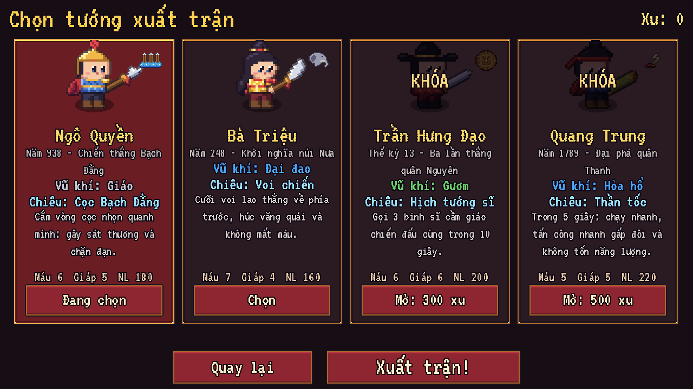
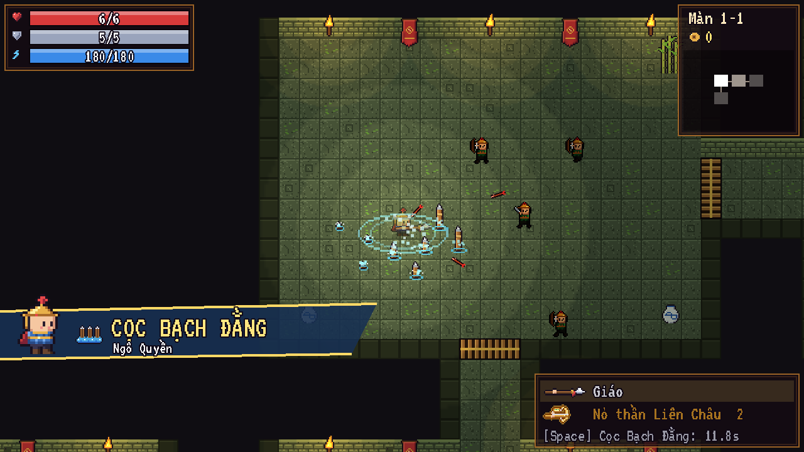
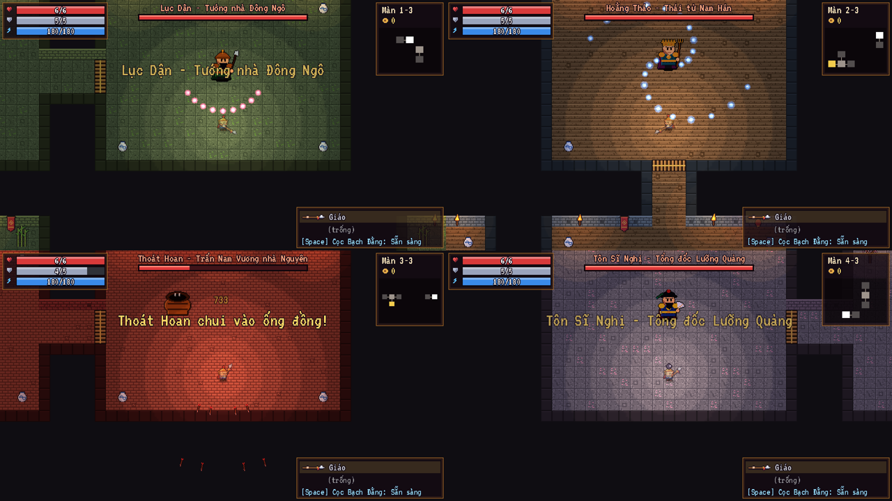
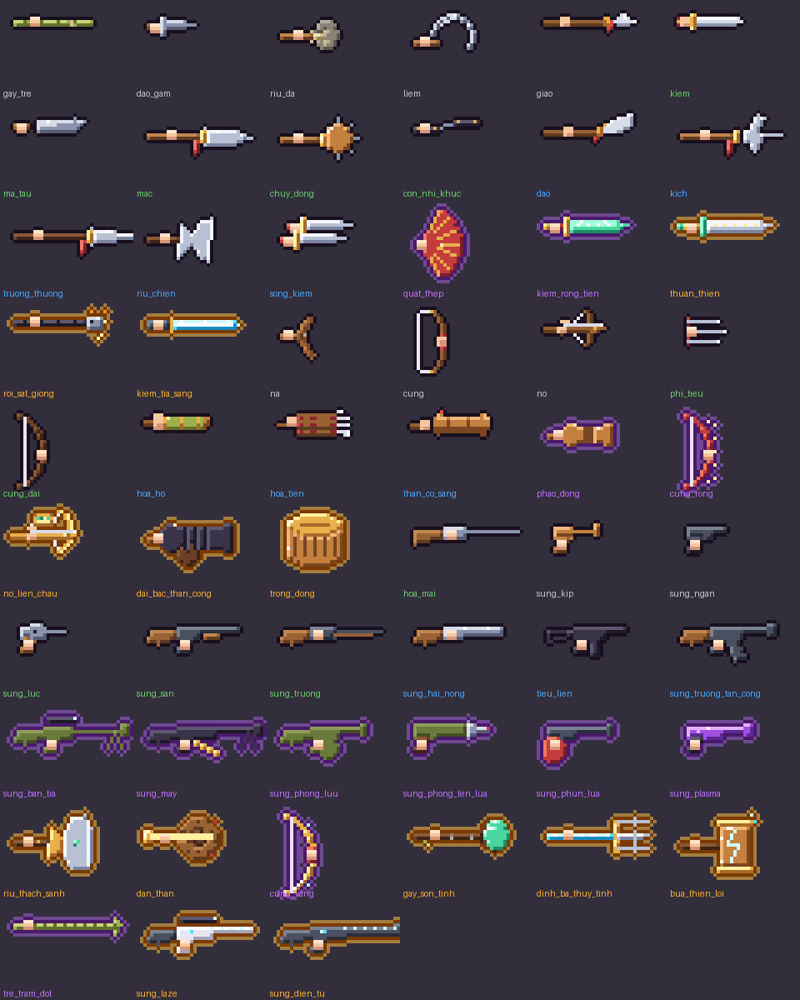
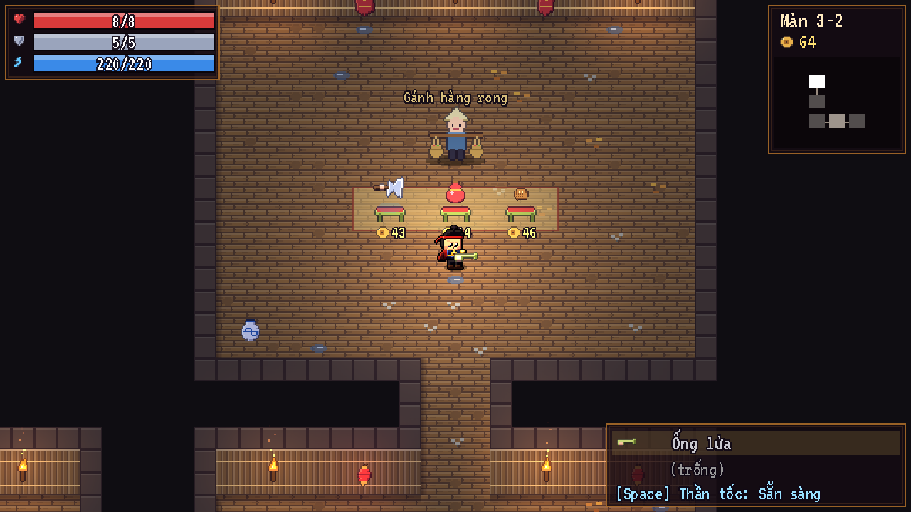
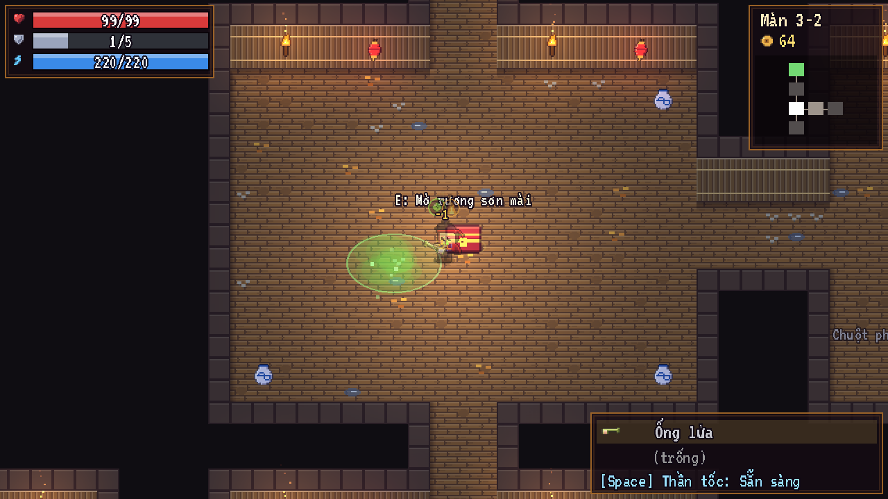

# Anh Hùng Đất Việt

> Game chỉ để chơi trong nhóm bạn: chơi một mình hoặc chơi chung qua LAN.
> - **Bàn giao cho Antigravity/Gemini: [docs/BAN-GIAO.md](docs/BAN-GIAO.md)**
> - Tiến độ và kế hoạch: [docs/TIEN-DO-VA-KE-HOACH.md](docs/TIEN-DO-VA-KE-HOACH.md)
> - Việc còn lại giao cho Gemini: [docs/GIAO-VIEC-GEMINI.md](docs/GIAO-VIEC-GEMINI.md) (luật làm việc: `AGENTS.md`)
> - Chạy test: `tools\run_tests.bat` (Windows) hoặc `bash tools/run_tests.sh` (Linux/Mac)

Game roguelike bắn quái góc nhìn từ trên xuống, đồ họa pixel. Người chơi chọn 1 trong **10 vị tướng** từ năm 40 đến năm 1954, đánh qua **10 chương lịch sử**, mỗi chương một đạo quân xâm lược và một trùm. Mỗi tướng khởi đầu bằng một vũ khí cơ bản riêng, vào trận nhặt thêm trong số 57 vũ khí chia 5 cấp (tổng 67 vũ khí).



| Cọc Bạch Đằng (Ngô Quyền) | Voi chiến (Bà Triệu) |
|---|---|
|  |  |
| **Hịch tướng sĩ (Trần Hưng Đạo)** | **Thần tốc (Quang Trung)** |
|  |  |

## Cách mở và chạy

1. Tải **Godot 4.7** (bản Standard) tại godotengine.org.
2. Mở Godot, bấm **Import**, chọn `project.godot`. Lần đầu Godot cần vài giây để nạp ảnh.
3. Bấm **F5** để chơi.

> Muốn thử điều khiển cảm ứng trên máy tính: vào *Debug → Customize Run Instances*, thêm `--touch` vào ô *Main Run Args*.

## Điều khiển

| | Máy tính | Điện thoại | Tay cầm |
|---|---|---|---|
| Di chuyển | WASD / phím mũi tên | Cần gạt trái | Cần trái |
| Tấn công | Giữ chuột trái (hoặc J) | Giữ nút vũ khí | A / cò phải |
| Ngắm | Theo chuột | Tự ngắm | Tự ngắm |
| Kỹ năng | Chuột phải / Space | Nút kỹ năng | B |
| Nhặt / đổi vũ khí | E hoặc Q | Nút **Đổi** | Y |
| Tạm dừng | Esc / P | Nút **II** | Start |

## 10 vị tướng và chiêu thức

Tướng được vẽ ở khung 32x32, có 4 khung thở, 4 khung đi, 1 khung trúng đòn. Mỗi tướng khởi đầu bằng một vũ khí cơ bản riêng: cấp Thường, không tốn năng lượng, không rơi ngẫu nhiên.

| Tướng | Vũ khí cơ bản | Chiêu | Hiệu ứng | Mở khóa |
|---|---|---|---|---|
| Hai Bà Trưng | Kiếm đồng Mê Linh | **Song Trưng** | Trưng Nhị hiện ra, đánh theo mọi đòn trong 8 giây | Có sẵn |
| Bà Triệu | Đoản đao | **Voi chiến** | Cưỡi voi húc văng giặc | Có sẵn |
| Ngô Quyền | Giáo tre | **Cọc Bạch Đằng** | Nước dâng, 14 cọc trồi lên đâm giặc, chặn đạn | Có sẵn |
| Lý Thường Kiệt | Nỏ tay | **Nam quốc sơn hà** | Vòng chữ thần xoay quanh, bật ngược đạn giặc | 200 xu |
| Trần Hưng Đạo | Gươm lệnh | **Hịch tướng sĩ** | Ấn trống đồng, 3 binh sĩ ra trận | 300 xu |
| Lê Lợi | Côn Lam Sơn | **Gươm Thuận Thiên** | 3 thanh gươm thần bay vòng quanh chém giặc | 400 xu |
| Quang Trung | Ống lửa | **Thần tốc** | Hào quang sét, chạy và đánh nhanh gấp đôi | 500 xu |
| Nguyễn Trung Trực | Dao rựa | **Hỏa hồng Nhật Tảo** | Ném 8 bầu lửa, biển lửa thiêu giặc | 600 xu |
| Hoàng Hoa Thám | Súng hỏa mai Yên Thế | **Hùm thiêng Yên Thế** | Tiếng hổ gầm làm choáng, hổ thần lao ra vồ | 700 xu |
| Chiến sĩ Điện Biên | Súng trường bộ binh | **Kéo pháo vào trận** | Đặt khẩu pháo tự động nã đạn 9 giây | 800 xu |

Khi tung chiêu, một băng chân dung tướng trượt ngang màn hình.

## 10 chương lịch sử (năm 40 đến năm 1954)

Có hư cấu cho kịch tính: pháp sư giặc dùng tà thuật gọi yêu quái dân gian ra trợ chiến.

Cột "Trùm gốc" là trùm gắn với chương theo lịch sử. Khi chơi, trùm được **xáo ngẫu nhiên** (xem mục "Trùm ngẫu nhiên" bên dưới).

| # | Chương | Quân địch | Trùm gốc | Chiêu đặc biệt của trùm |
|---|---|---|---|---|
| 1 | Mê Linh, năm 40 | Đông Hán | **Tô Định** | Cắt tóc cạo râu, trà trộn bỏ chạy |
| 2 | Núi Nưa, năm 248 | Đông Ngô | **Lục Dận** | Bày trận khiên |
| 3 | Bạch Đằng, năm 938 | Nam Hán | **Hoằng Tháo** | Gọi Thủy quái Ngư Tinh |
| 4 | Như Nguyệt, năm 1077 | Tống | **Quách Quỳ** | Mưa tên |
| 5 | Thăng Long, năm 1285 | Nguyên Mông (có kỵ binh) | **Thoát Hoan** | Chui vào ống đồng |
| 6 | Chi Lăng, năm 1427 | Minh | **Liễu Thăng** | Sa lầy ải Chi Lăng |
| 7 | Đống Đa, năm 1789 | Thanh | **Tôn Sĩ Nghị** | Bỏ cả ấn tín mà chạy |
| 8 | Nhật Tảo, năm 1861 | Thủy quân Pháp | **Tàu chiến Hy Vọng** | Bốc cháy |
| 9 | Yên Thế, năm 1890 | Quân viễn chinh Pháp | **Đồn trưởng Nhã Nam** | Gọi pháo kích |
| 10 | Điện Biên Phủ, năm 1954 | Tập đoàn cứ điểm (có xe tăng) | **Đờ Cát** | Rút vào hầm chỉ huy |

### Trùm ngẫu nhiên, sức mạnh tăng dần

- **Thứ tự ngẫu nhiên**: mỗi lượt chơi xáo cả 10 trùm. Trùm cuối màn 3, 6, 9… là con nào cũng được, và không gặp lại cho tới khi đã đánh đủ 10 con. Sang vòng 2 thì xáo lại, và không gặp lại ngay con vừa đánh.
- **Sức mạnh theo thứ tự gặp, không theo từng con**: trùm thứ nhất luôn yếu nhất, trùm thứ mười mạnh nhất, dù là Tô Định hay Đờ Cát.

  | Trùm thứ | 1 | 2 | 3 | 4 | 5 | 6 | 7 | 8 | 9 | 10 |
  |---|---|---|---|---|---|---|---|---|---|---|
  | Máu | 300 | 426 | 552 | 678 | 804 | 930 | 1056 | 1182 | 1308 | 1434 |

  Mỗi bậc còn tăng thêm:
  - Ra chiêu nhanh hơn 6%, tối đa khoảng 42%.
  - Đạn bay nhanh hơn 3,5%.
  - Cứ 4 bậc gọi thêm 1 lính.
  - Cứ 5 bậc đánh cận thân mạnh thêm 1.
- Mỗi trùm vẫn giữ **bộ chiêu, chiêu đặc biệt và quân riêng của mình**. Ví dụ Đờ Cát xuất hiện ở chương Mê Linh thì vẫn gọi xe tăng Pháp.
- Khi vào phòng trùm, dòng thông báo ghi rõ "Trùm thứ N".

### Trùm hiện nguyên hình (2 giai đoạn)

Khi còn nửa máu, trùm đứng khựng lại và bất khả xâm phạm 1,4 giây. Đạn trên sân bị xóa, khói tà khí cuộn lên, rồi trùm **hiện nguyên hình** thành ma tướng. Đây là phần hư cấu: giặc dùng tà thuật.

- To gấp đôi, có sừng, tai, vây hoặc gai riêng, mắt rực, nanh nhọn và hào quang tà khí.
- Đổi sang **bộ chiêu giai đoạn 2** và mở bộ chiêu nổi giận (chướng khí, hỏa tiễn).
- Các hình này được tạo tự động từ hình gốc của từng trùm bằng `tools/sprites/art_demons.py`: phóng to Scale2x, đổi da, mọc sừng, thêm hào quang.

| Trùm | Hình ma tướng |
|---|---|
| Tô Định | Quỷ Tham Tàn (sừng trâu) |
| Lục Dận | Quỷ Gai Đông Ngô (gai nhọn) |
| Hoằng Tháo | Thủy Quỷ Nam Hán (vây cá) |
| Quách Quỳ | Ưng Quỷ Tống Triều (mào ưng) |
| Thoát Hoan | Lang Quỷ Thảo Nguyên (tai sói) |
| Liễu Thăng | Quỷ Rừng Sa Lầy (gạc cành mục) |
| Tôn Sĩ Nghị | Ngưu Quỷ Lưỡng Quảng |
| Tàu Hy Vọng | Tàu Ma Lửa Xanh |
| Đồn trưởng Nhã Nam | Quỷ Gai Đồn Bốt |
| Đờ Cát | Ngưu Quỷ Hầm Ngầm |


### Tam Yêu: trùm truyền thuyết giữa chương

Theo truyền thuyết, Lạc Long Quân đã diệt ba yêu quái Ngư Tinh, Hồ Tinh và Mộc Tinh. Ở màn giữa mỗi chương (màn 2, 5, 8…), phòng cổng ra có **40%** bị một trong Tam Yêu canh giữ (ô tím trên bản đồ nhỏ). Yêu được chọn ngẫu nhiên và không gặp lại ngay con vừa gặp.

- Máu tăng theo thứ tự gặp như trùm chính (từ 260).
- Diệt xong được cổng ra, 1 vũ khí xịn và nhiều xu.

| Yêu | Chiêu | Chiêu đặc biệt | Hiện nguyên hình |
|---|---|---|---|
| **Hồ Tinh**, cáo chín đuôi đầm Xác Cáo | Quạt lửa hồ ly theo số đuôi, phân thân thành bầy cáo ảo | Xòe chín đuôi, lửa xoáy ngập trời | Từ 3 đuôi lửa cam thành **Cửu Vĩ Hồ Ly** 9 đuôi lửa xanh |
| **Mộc Tinh**, cây chiên đàn nghìn năm | Rễ cây trồi thành hàng về phía người chơi, gọi Mộc tinh con | Hút linh khí rừng già: hồi 12% máu, gọi 3 cây con | Tán lá đỏ rực, lửa trên tán, mắt đỏ, mỗi lần mọc 2 hàng rễ |
| **Ngư Tinh**, thủy quái Biển Đông | Lặn xuống (không trúng đòn) rồi trồi lên dưới chân người chơi tung vòng nước, tường nước có khe hở | Sóng thần: 3 bức tường nước | **Ngư Tinh Hắc Hải** vảy tím, vây đỏ, sóng dày hơn |


- **Thời phong kiến**: bộ binh, cung thủ, khiên binh (đỡ đòn phía trước), pháp sư (gọi yêu quái).
- **Thời cận đại**: lính lưỡi lê, lính súng trường, xạ thủ súng máy (bắn loạt), pháo cối (vòng đỏ báo trước rồi nổ), xe tăng.
- **Yêu quái**: Tiểu yêu, Hồ tinh, Mộc tinh, Chằn tinh (dậm đất tung vòng đạn), Đại bàng tinh (lao bổ nhào), Ma trơi (lao vào rồi nổ).
- Có 7 kiểu gạch nền: đất làng, rừng rêu, sàn gỗ, gạch đỏ Thăng Long, đá Đống Đa, đồn Pháp, chiến hào bao cát.
- Sau chương 10, game quay lại chương 1 với giặc mạnh hơn.
- Game chưa có kháng chiến chống Mỹ: giai đoạn này còn quá gần và nhạy cảm khi phát hành quốc tế. Chương Điện Biên dùng hình tượng chung "Chiến sĩ Điện Biên" thay vì một nhân vật có thật.



## 67 vũ khí (10 cơ bản + 57 nhặt trong trận), 5 cấp

Màu cấp: **Thường** (xám), **Tốt** (xanh lá), **Hiếm** (xanh dương), **Sử thi** (tím, hình có viền tím), **Huyền thoại** (vàng cam, hình có viền vàng phát sáng). Vũ khí rơi trên đất có cột sáng màu theo cấp. Màn càng sâu, rương và trùm càng dễ ra đồ xịn.

- **Cận chiến**: Gậy tre, Dao găm, Rìu đá, Lưỡi liềm, Giáo, Gươm, Mã tấu, Mác, Chùy đồng, Côn nhị khúc, Đại đao, Kích, Trường thương, Rìu chiến, Song kiếm, Quạt thép, Kiếm Rồng Tiên, Gươm Thuận Thiên, Roi sắt Thánh Gióng, Kiếm tia sáng
- **Bắn xa thời xưa**: Ná, Cung tên, Nỏ, Phi tiêu, Cung dài, Hỏa hổ, Hỏa tiễn, Súng thần cơ, Pháo đồng, Cung Lạc Long, Nỏ thần Liên Châu, Đại bác thần công, Trống đồng thần, Súng hỏa mai
- **Cận đại và hiện đại**: Súng kíp, Súng ngắn, Súng lục ổ quay, Súng săn, Súng trường, Súng hai nòng, Tiểu liên, Súng trường tấn công, Súng bắn tỉa, Súng máy, Súng phóng lựu, Súng phóng tên lửa, Súng phun lửa, Súng plasma, Súng laze, Súng điện từ
- **Truyền kỳ Việt Nam**:
  - Rìu Thạch Sanh: ném ra rồi bay vòng về
  - Đàn thần Thạch Sanh: làm giặc choáng
  - Cung vàng Thạch Sanh: tên tự đuổi mục tiêu
  - Gậy thần Sơn Tinh: dâng gai đá
  - Đinh ba Thủy Tinh: sóng nước
  - Búa Thiên Lôi: sét lan 5 kẻ địch
  - Cây tre trăm đốt: roi dài

Cơ chế vũ khí: vung, đâm, xoay, sóng kiếm, nổ lan, xuyên, đuổi mục tiêu, bay về tay, tia laze, sóng âm làm choáng, gai đá, sét lan.



## Doanh trại Anh Hùng (sảnh chính)


Cảnh vật trong doanh trại:

- Hàng cột đình sơn son và thảm đỏ viền vàng dẫn tới cổng.
- Lư hương tỏa khói, hai trống đồng trên giá, mặt trống đồng giữa sân.
- Đôi nghê đá canh cổng.
- Ao có lá sen, hoa sen, cá koi bơi và đom đóm.
- Cây đào, bonsai, khóm tre.
- Lính tuần tra đi lại, gà con chạy nhặt thóc, cánh hoa đào rơi.

Từ màn hình chính bấm **Vào doanh trại**. Đây là căn phòng đi lại tự do như sảnh của Soul Knight. Đến gần một điểm rồi bấm **E** (hoặc nút **Dùng** trên điện thoại):

| Điểm | Chức năng |
|---|---|
| 10 vị tướng | Xem thông tin, đổi tướng, mở khóa bằng xu |
| Lò rèn | Nâng cấp vĩnh viễn: máu, giáp, năng lượng, Lễ xuất quân (khởi đầu với 1 phúc lành), Thuốc hồi sinh (hồi sinh miễn phí 1 lần mỗi lượt) |
| Giá binh khí | Bộ sưu tập 67 vũ khí; vũ khí chưa nhặt được hiện bóng đen |
| Hình nhân rơm | Đánh thử vũ khí và chiêu, có hiện sát thương mỗi giây |
| Bia ghi công | Số lượt chơi, giặc đã hạ, trùm đã đánh bại, màn cao nhất |
| Cổng xuất trận | Bước vào để bắt đầu lượt chơi |

## Phúc lành (tăng sức mạnh mỗi màn)

Qua mỗi màn được chọn **1 trong 3 phúc lành**, cộng dồn suốt lượt chơi và hiện thành biểu tượng dưới thanh máu. Có 16 loại: Bánh chưng (+máu), Giáp đồng, Rượu thuốc (+sát thương), Ngựa ô (+tốc độ), Bùa hộ mệnh (né đòn), Đá mài gươm, Hỏa dược (nổ to hơn), Trà tim sen (hồi chiêu nhanh), Mắt thần (chí mạng), Linh khí, Huyết sâm (hút máu), Bội thu (+xu), Giày cỏ (đánh nhanh), Mũi tên đôi (+1 viên), Khiên chấn động, Ngọc bích (hồi năng lượng).

## Nhặt vũ khí

- Vũ khí rơi trên đất có **cột sáng màu theo cấp** và **mũi tên chỉ**. Đứng gần sẽ hiện tên, mô tả và chỉ số (sát thương, tốc độ, năng lượng).
- Bấm **E** hoặc nút **Nhặt** (nút nhấp nháy vàng khi có vũ khí dưới chân) để nhặt. Mang tối đa 2 vũ khí; nhặt thêm thì vũ khí đang cầm rơi xuống đất.
- Nguồn vũ khí:
  - Phòng đầu ở màn 1 luôn có sẵn 1 vũ khí.
  - Rương sơn mài sau mỗi phòng đánh (15%).
  - Kệ hàng của gánh hàng rong (mua bằng xu).
  - Rương ở phòng kho báu.
  - Giặc tinh nhuệ rơi 45%.
  - Trùm luôn rơi.
- **Giặc tinh nhuệ** to hơn, phát sáng vàng, trâu gấp 2,4 lần, rơi gấp 3 xu và dễ rơi vũ khí. Càng vào sâu càng gặp nhiều.

## Rương, chợ, hồ lô và trạng thái



Phần này học ý tưởng từ bản làm lại Soul Knight bằng C++ (CalvinWan0101/soul-knight). Chỉ lấy ý tưởng, không dùng mã hay hình của họ. Tất cả đã đổi sang chất Việt:

- **Rương sơn mài**: hiện ra sau mỗi phòng đánh đã dọn sạch. Đứng gần bấm **E** để mở.
  - 58%: xu và linh khí.
  - 27%: hồ lô thuốc.
  - 15%: vũ khí.
- **Gánh hàng rong**: từ màn 2, 65% mỗi màn có một phòng chợ (ô xanh lá trên bản đồ nhỏ). Bà hàng đội nón lá, gánh hai thúng, bày 3 kệ tre:
  - 1 vũ khí.
  - 1 hồ lô (lớn hoặc linh khí).
  - 1 lá bùa phúc lành.

  Trả bằng xu nhặt trong lượt chơi.
- **Hồ lô**:
  - Hồ lô nhỏ: +2 máu.
  - Hồ lô lớn: +5 máu.
  - Hồ lô linh khí: +80 năng lượng.

  Hồ lô máu cũng giải độc và dập lửa.
- **Trạng thái**: có biểu tượng trên đầu, gây sát thương theo nhịp và trừ giáp trước.
  - **Cháy**: do cầu lửa và biển lửa Hỏa hồng. Vũ khí lửa của ta cũng đốt được giặc.
  - **Trúng độc**: do đạn tà thuật của pháp sư và đám **chướng khí**.


- **Trùm nổi giận**: khi còn nửa máu, trùm viền đỏ, gầm lên và mở thêm một bộ chiêu chạy song song với chiêu thường. Bộ chiêu này luân phiên giữa thả chướng khí dưới chân người chơi và quạt 5 quả hỏa tiễn.

## Cấu trúc thư mục

```
assets/sprites/      Toàn bộ đồ họa pixel (PNG). Có thể mở và sửa bằng Aseprite.
assets/fonts/        Font VT323 (hỗ trợ tiếng Việt, giấy phép OFL)
tools/sprites/       Công cụ Python vẽ ra toàn bộ đồ họa (xem bên dưới)
scenes/              Màn hình: main_menu, hero_select, game
scripts/
  data/heroes.gd       Danh sách tướng
  data/weapons.gd      57 vũ khí: chỉ số, cấp, cơ chế
  data/enemies.gd      Quân địch, trùm, 4 chương
  art/art.gd           Nạp ảnh, hoạt ảnh, font, hiệu ứng nháy trắng, ánh sáng
  entities/            Người chơi, địch, đạn, vật phẩm, cọc, binh sĩ, cửa, cổng
  effects/             Hiệu ứng: hạt, nổ, tia laze, sóng, gai đá, sét, ấn trống đồng
  game/                Màn chơi, sinh hầm ngục, phòng, đồ trang trí
  ui/                  Giao diện, nút cảm ứng, menu
tests/               Kiểm thử tự động
```

## Sách tranh pixel art

Toàn bộ đồ họa được vẽ tay từng pixel bằng code, có thể xem phóng to trong `docs/artbook/`:

| Trang | Nội dung |
|---|---|
| `1-tuong.png` | 10 vị tướng, khung 32x32, đủ 9 khung hoạt ảnh, vũ khí cơ bản và biểu tượng chiêu |
| `2-quan-dich.png` | 10 đạo quân, kỵ binh, xe tăng, 7 loại yêu quái |
| `3-trum.png` | 10 trùm (kể cả Tàu chiến Hy Vọng) và Thủy quái Ngư Tinh |
| `4-vu-khi.png` | 67 vũ khí xếp theo 5 cấp |
| `5-hieu-ung.png` | Hiệu ứng chiêu thức: cọc, voi, trống đồng, hào quang, nổ, cổng… |

Kỹ thuật vẽ: tướng 32x32 với 3–4 tông màu cho mỗi chất liệu. Viền màu theo vật thể (selective outline) thay cho viền đen. Vũ khí Sử thi có viền tím, Huyền thoại có viền vàng phát sáng.

Vẽ lại sách tranh:

```bash
python3 tools/sprites/artbook.py
```

## Sửa và thêm đồ họa

Tướng, lính, yêu quái và trùm đều qua bước hoàn thiện `polish()` trong `tools/sprites/px.py`. Bước này học kỹ thuật chung của pixel art chibi khi tham khảo thư mục Resources của bản Soul Knight C++ (chỉ học cách vẽ, không sao chép hình):

- Viền ngoài gần đen.
- Mỗi mảng màu có mép sáng ở trên, mép tối ở dưới, và nét chia vùng ở chỗ hai màu tương phản gặp nhau.
- Ánh sáng từ góc trên trái; nửa dưới thân tối dần.
- Mảng màu lớn được rắc vân nhẹ.

Mọi hình đều là tệp PNG trong `assets/sprites/`, có thể sửa trực tiếp bằng Aseprite hoặc LibreSprite. Muốn vẽ lại toàn bộ bằng công cụ (ví dụ sau khi sửa lưới pixel của tướng trong `tools/sprites/art_heroes.py`), chạy:

```bash
pip install pillow
```

```bash
python3 tools/sprites/build_all.py
```

Tướng được vẽ tay từng pixel bằng lưới ký tự (mỗi ký tự là một màu). Bạn có thể sửa trực tiếp lưới đó để đổi trang phục, mũ, râu…

## Thêm nội dung

- **Vũ khí mới**: thêm một mục vào `scripts/data/weapons.gd`, vẽ hình tại `assets/sprites/weapons/<mã>.png`, rồi chạy lại `build_all.py` để cập nhật điểm cầm (grips.json). Cách khác là thêm một dòng vào `PROC` trong `tools/sprites/art_weapons.py`.
- **Tướng mới**: thêm vào `scripts/data/heroes.gd` và một lưới pixel trong `art_heroes.py`. Kỹ năng mới viết trong `_use_skill()` ở `scripts/entities/player.gd`.
- **Chương hoặc trùm mới**: thêm vào `CHAPTERS` và `BOSSES` trong `scripts/data/enemies.gd`.

## Kiểm thử tự động

```bash
godot --headless --path . res://tests/check_scripts.tscn
```

```bash
godot --headless --path . --fixed-fps 60 res://tests/smoke_test.tscn
```

Lệnh đầu kiểm tra mọi script biên dịch được. Lệnh sau chơi thử: thử chiêu của cả 10 tướng, dùng cả 67 vũ khí, đi hết 30 màn (10 trùm xáo ngẫu nhiên, kiểm tra không trùng và máu tăng dần, kiểm tra 20 lần hiện nguyên hình của 10 trùm và Tam Yêu, kích hoạt chiêu đặc biệt và cơn nổi giận của từng trùm), mở rương sau mỗi phòng, mua hết hàng ở mọi gánh hàng rong, thử trúng độc và chướng khí, chết rồi hồi sinh. Kết quả in `SMOKE TEST OK` nếu không có lỗi.

## Bước tiếp theo

1. **Âm thanh**: tiếng chém, bắn, nổ, trống đồng; nhạc nền theo từng chương.
2. **Hoạt ảnh tấn công riêng** cho từng tướng và trùm.
3. **Cân bằng độ khó**: hiện chỉ mới kiểm tra là game chạy đúng, chưa chơi thử bằng tay để chỉnh độ khó.
4. **Xuất bản Android** và gắn AdMob vào hàm `show_rewarded_ad()` trong `scripts/autoload/global.gd`.

## Lưu ý về nội dung lịch sử

- Các vị tướng được thể hiện kiểu chibi đáng yêu nhưng trang trọng.
- Kẻ địch là các đạo quân xâm lược thời phong kiến, gắn với các trận đánh có thật. Game không chế giễu dân tộc nào.
- Nếu định phát hành ở thị trường nước ngoài, nên xem lại quy định nội dung của từng nơi.
