<div align="center">

# ⚔️ ANH HÙNG ĐẤT VIỆT ⚔️

### Phiên bản `v3.0.0` — *Giang Sơn Gấm Vóc*

*Game hành động Roguelike bắn quái góc nhìn từ trên xuống (Top-Down Bullet-Hell) kết hợp Thủ Thành Cổ Loa & LAN Co-op — Tái hiện hào khí 2.000 năm lịch sử & truyền thuyết Việt Nam bằng đồ họa Pixel Art và âm nhạc ngũ cung Stereo.*

[](https://github.com/Anhle26-per/anh-hung-dat-viet/releases/latest)
[](https://godotengine.org/)
[](#%EF%B8%8F-225-binh-khí-hợp-nhất--thần-binh-đỏ)
[](#-14-danh-tướng--nội-tại-chiêu-1--chiêu-2)
[](#-hệ-thống-âm-thanh-441-khz-stereo--nhạc-ngũ-cung)
[](#-tải-game--cài-đặt)

</div>

---

<div align="center">

| Thủ Thành Cổ Loa (Thành Ốc & Lõi Nỏ Thần) | Đại Tướng Công Thành (Đợt 5 Cổ Loa) |
| :---: | :---: |
| 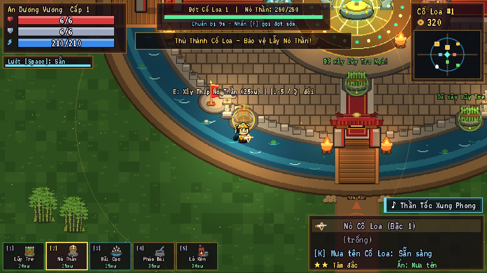 | 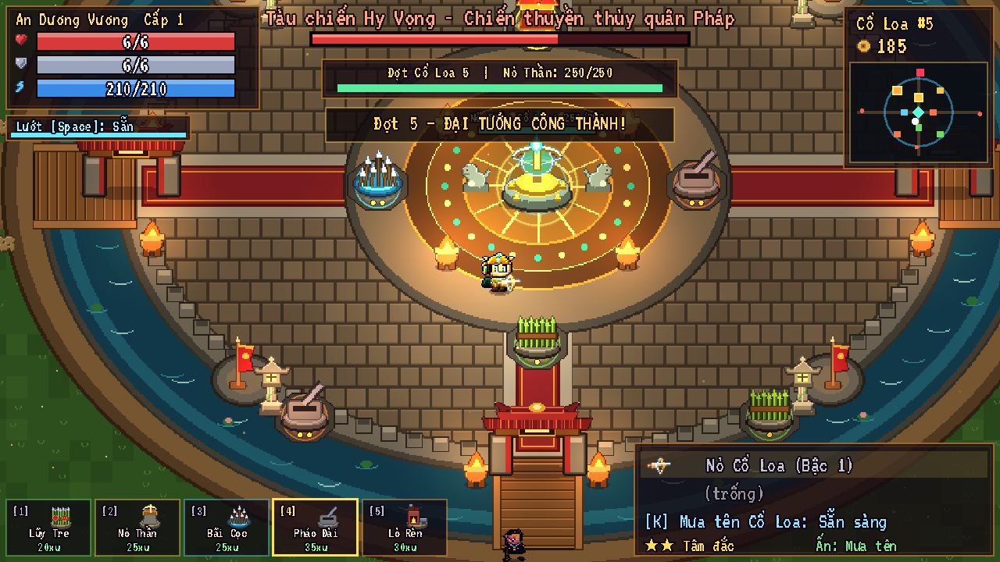 |
| **3 Tướng Truyền Thuyết Mới, Skin & Cây Thiên Phú** | **2 Bí Cảnh, Hào Khí 1..10 & Kết Thúc Thực Màn 33** |
| 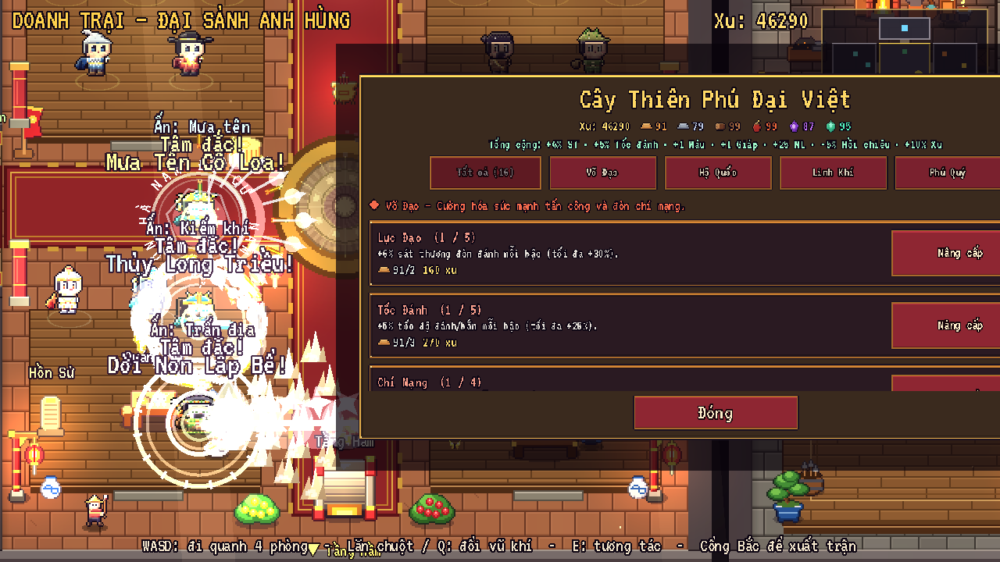 | 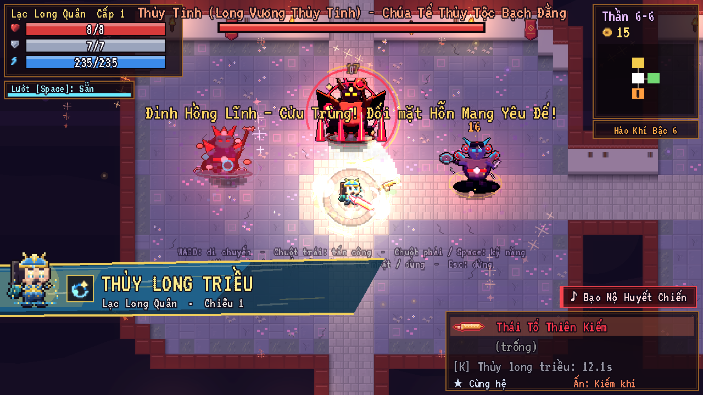 |

</div>

---

## 📦 Tải Game & Cài Đặt

Tất cả bản dựng chính thức được phát hành tại trang [**GitHub Releases**](https://github.com/Anhle26-per/anh-hung-dat-viet/releases/latest):

| Nền tảng | Tải trực tiếp | Cách chạy nhanh |
|---|---|---|
| **Windows (`.zip`)** | [**AnhHungDatViet-Windows.zip**](https://github.com/Anhle26-per/anh-hung-dat-viet/releases/latest/download/AnhHungDatViet-Windows.zip) | Giải nén toàn bộ thư mục và mở `AnhHungDatViet.exe` |
| **Gói cập nhật (`.pck`)** | [**AnhHungDatViet.pck**](https://github.com/Anhle26-per/anh-hung-dat-viet/releases/latest/download/AnhHungDatViet.pck) | Dùng cho tính năng tự động cập nhật trong game |
| **macOS / Android** | [**Xem tại Releases**](https://github.com/Anhle26-per/anh-hung-dat-viet/releases/latest) | Xem thêm [Hướng dẫn cài chi tiết](docs/HUONG-DAN-CAI.md) |

> 💡 **Tự Động Cập Nhật Ngay Trong Game (Hotpatch `patch.pck`)**  
> Từ các phiên bản `v1.2.9+`, khi mở game ở màn hình chính, hệ thống tự kiểm tra bản mới nhất trên GitHub và cho phép **bấm 1 nút để tải bản vá `.pck`**, áp dụng ngay không cần tải lại cả bộ cài và vẫn **giữ nguyên toàn bộ file lưu cũ** (tướng, xu, nguyên liệu, bản vẽ, cây thiên phú, thành tựu).

---

## 🔥 Điểm Nhấn Phiên Bản `v3.0.0 — Giang Sơn Gấm Vóc`

### 1. Trụ Cột 1 — Thủ Thành Cổ Loa (Đại Tu Toàn Diện) & LAN Chiến Thuật
- **Thành Ốc Cổ Loa (`world/coloa_bg.png`)**: Bản đồ chiến lũy xoáy ốc `1152×832` hoàn chỉnh với hào nước xanh, 4 cầu gỗ + 4 cổng mái cong Việt (*Bắc Môn, Nam Môn, Tây Môn, Đông Môn*), 12 lò lửa `PointLight2D`, tượng Nghê hộ thành, cờ hiệu, đèn đá, bụi tre đung đưa và quảng trường Trống Đồng Đông Sơn ở trung tâm.
- **Lõi Nỏ Thần Cổ Loa (`co_loa_core.gd`)**: Hoạt ảnh 4 khung hình phát sáng, tự bắn 3 tia Nỏ Thần Kim Quy hộ vệ khi giặc áp sát, có điểm tương tác tu sửa (`[E]` hồi `+35 HP / 20 xu`).
- **5 Loại Tháp Canh 3 Bậc (`defense_tower.gd`)**: Mỗi loại tháp sở hữu bộ sprite động 2 khung theo từng bậc `t1 → t3`, hoạt ảnh giật khi bắn, hologram + vòng tầm bắn xem trước khi đứng gần bệ trống, chọn nhanh bằng phím **`[1]..[5]`** hoặc **`[Q]`** trên thanh xây tháp góc dưới trái, kèm bản đồ nhỏ Cổ Loa riêng:
  - **`[1]` Lũy Tre Làng** (`20 xu`): Chắn địch & hồi phục nhẹ xung quanh.
  - **`[2]` Tháp Nỏ Thần** (`25 xu`): Bắn loạt tên xuyên thấu tầm xa.
  - **`[3]` Bãi Cọc Bạch Đằng** (`25 xu`): Sóng cọc AoE đẩy lùi và làm chậm giặc.
  - **`[4]` Pháo Đài Điện Biên** (`35 xu`): Pháo hạng nặng nổ rộng + gây choáng.
  - **`[5]` Lò Rèn Dã Chiến** (`30 xu`): Hồi giáp, hồi năng lượng đồng minh và sửa chữa Nỏ Thần.
- **Ping Chiến Thuật (`PingMarker`) & Tổng Kết Trận (`MatchSummary`)**: Bấm **`T`** (hoặc D-Pad Lên) để đặt Ping đồng bộ qua LAN (*Tập trung!*, *Nguy hiểm!*, *Nhặt đồ!*, *Hợp chiêu!*); xem **Bảng Tổng Kết Trận & MVP** sau khi kết thúc lượt; thử sức tại **Võ Đài Tỷ Thí (`SparringArena`)**.

### 2. Trụ Cột 2 — 3 Tướng Mới, Skins, 15 Cổ Vật & Cây Thiên Phú 16 Nút
- **3 Danh Tướng Truyền Thuyết Mới**: **An Dương Vương**, **Lạc Long Quân**, **Sơn Tinh** (nâng tổng đội hình lên **14 Tướng • 28 Kỹ năng**), đi cùng hệ thống **Hero Skins** đổi diện mạo và màu hiệu ứng chiêu thức.
- **Cây Thiên Phú Vĩnh Viễn (`SkillTreeData`, 16 nút / 4 nhánh)**: Nâng cấp vĩnh viễn tại Doanh Trại qua 4 nhánh **Võ Đạo**, **Hộ Quốc**, **Linh Khí**, **Phú Quý**.
- **15 Cổ Vật Sử Việt (`RelicData`)**, **12 Bùa Vũ Khí** & **8 Thuộc Tính Ngẫu Nhiên (`Affixes`)** rèn ghép đa dạng hóa lối chơi mỗi lượt.
- **225 Binh Khí**: Bổ sung vũ khí khởi đầu riêng cho 3 tướng mới (*Nỏ Cổ Loa*, *Long Uyên Kiếm*, *Búa Tản Viên*), **Thần Binh Hợp Nhất** mới và các Thần Binh Đỏ từ Trùm Bí Cảnh & Màn 33.

### 3. Trụ Cột 3 — 2 Bí Cảnh, Hào Khí 1..10 & Kết Thúc Thực Màn 33
- **Cổng Rẽ Nhánh Bí Cảnh (`portal_entered_branch`)**: Xuất hiện cơ hội rẽ vào **Thủy Cung Long Vương** hoặc **Đỉnh Tản Viên**, đối đầu Trùm Bí Cảnh **48 khung hình** mang về Thần Binh Đỏ hiếm.
- **Độ Khó Hào Khí Đại Việt (`HaoKhiData`, Bậc 1..10) & Boss Pha 3**: Tăng tiến máu/sát thương/tốc độ, giáp tinh anh, bẫy chiến trường, mở khóa **Giai Đoạn 3 Cuồng Nộ Đỉnh Điểm** cho Đại Trùm, đồng thời tăng hệ số xu, mảnh bản vẽ và cơ hội Cổ Vật.
- **Kết Thúc Thực Màn 33 (*Đỉnh Hồng Lĩnh — Cửu Trùng*)**: Đánh bại **Hỗn Mang Yêu Đế** để mở trang Hồn Sử tối thượng và tiến vào **Cửu Trùng Khải Hoàn (Màn 34)**.

### 4. Trụ Cột 4 — 4 Thần Thú Thức Tỉnh, 4 NPC Giải Cứu, Vườn 6 Luống & 24 Hồn Sử
- **Giải Cứu 4 NPC Doanh Trại (`CampNpcs`)**: *Danh Y Tuệ Tĩnh* (mở **Vườn Thảo Dược 6 luống** + Linh Chi Vàng & Hoa Ưu Đàm), *Nghệ Nhân Phù Lãng* (mở **Đài Thức Tỉnh Thần Thú** + giảm 20% nguyên liệu), *Quân Sư Cổ Loa* (mở Gieo Quẻ Quán Trà & Cổ Loa), *Võ Sư Thiên Nam* (mở Võ Đài Tỷ Thí).
- **4 Thần Thú Thức Tỉnh**: *Cún Vàng → Nghê Thần Lửa*, *Mèo Tam Thể → Linh Miêu Chiêu Bảo*, *Gà Trống Chọi → Kim Kê Mặt Trời*, *Chim Hạc Trắng → Lạc Điểu Hồng Bàng*.
- **24 Hồn Sử Đại Việt & Mở Rộng Thành Tựu**.

### 5. Hệ Thống Âm Thanh 44.1 kHz Stereo & Nhạc Ngũ Cung
Toàn bộ bộ tổng hợp `tools/audio/build_audio.py` được nâng cấp từ mono 22.05 kHz lên **44.1 kHz 16-bit**, nhạc nền **Stereo có panning nhạc cụ + circular reverb nối vòng không khựng**:
- **19 Bản Nhạc Nền Ngũ Cung** *(chuyển mượt 2 kênh crossfade)*: Bổ sung **5 bản nhạc mới** — *Hào Khí Thành Cổ Loa* (`coloa_defense`), *Cổ Loa Công Thành* (`coloa_siege`), *Thủy Cung Long Vương* (`secret_thuy_cung`), *Đỉnh Tản Viên Linh Thiêng* (`secret_tan_vien`), và *Hỗn Mang Diệt Thế* (`boss_hon_mang` cho Màn 33).
- **90 Hiệu Ứng Âm Thanh (SFX)** *(tối đa 8 giọng đồng thời + chống spam 50ms)*: Đủ **14 tiếng chiêu riêng cho cả 14 Tướng**, lớp âm Chiêu 2 (`skill2_cast`), **32 nhóm âm thanh vũ khí phủ toàn bộ 225 binh khí**, bộ SFX Cổ Loa (*xây tháp, nâng tháp, sửa Lõi, Nỏ Thần Kim Quy, trống đồng gọi đợt, chuông báo động Lõi*), 4 âm Ping chiến thuật, âm nâng Cây Thiên Phú & Thức Tỉnh Thần Thú.

<details>
<summary>📜 <strong>Xem lại Điểm Nhấn `v2.4.0` & `v2.3.0`</strong></summary>

- **`v2.4.0 — Hồn Sử Đại Việt`**: Bức Tường Kỷ Vật Đại Sảnh (`TrophyWallDisplay`), Hợp Chiêu Đại Việt LAN Co-op (`CoopSynergyData`, `CoopComboFx`), Thời tiết từng chương + Bloom (`WeatherFx`), Vệt đòn & vết chiến trường (`GroundDecal`), Võ Đường đo DPS thực thời & Giá Thử Binh Khí.
- **`v2.3.0 — Tuyệt Kỹ & Hoạt Ảnh Mượt`**: Hiệu ứng tung chiêu đa tầng (`SkillCastFx`) đồng bộ LAN, Tướng 28 khung, Quái 24 khung, Trùm 48 khung (`12×4`).

</details>

---

## 🎮 Bảng Điều Khiển

| Hành động | Máy tính (`PC`) | Điện thoại (`Touch`) | Tay cầm (`Gamepad`) |
|---|---|---|---|
| **Di chuyển** | `WASD` / Phím mũi tên | Cần gạt trái | Cần trái |
| **Tấn công / Tụ lực** | Giữ `Chuột trái` / `J` | Giữ nút Tấn công | `A` / Cò phải (`RT`) |
| **Ngắm bắn** | Theo trỏ chuột | Tự động ngắm | Tự động ngắm |
| **Tung Kỹ năng** | `Chuột phải` / `K` | Nút Kỹ năng | `B` |
| **Lướt né (i-frame)** | `Space` | Nút Lướt | `X` |
| **Chạy nhanh** | `Shift` | — | `L3` / `LT` |
| **Đổi vũ khí** | `Q` / Lăn chuột | Nút **Đổi** | `LB` |
| **Vứt vũ khí (chia sẻ LAN)** | `G` *(khi cầm ≥ 2 món)* | Nút **Vứt** | `D-Pad Xuống` |
| **Nhặt / Tương tác / Xây Tháp** | `E` | Nút **Nhặt / Dùng** | `Y` |
| **Hợp nhất vũ khí** | `R` *(cạnh đồ ghép được)* | Nút **Hợp nhất** | `RB` |
| **Cổ Loa: Chọn Tháp / Gọi Đợt** | `1..5` (hoặc `Q` khi rảnh) / `F` | Thanh chạm Cổ Loa | `D-Pad` |
| **Ping Chiến Thuật LAN** | `T` | Nút **Ping** | `D-Pad Lên` |
| **Tạm dừng** | `Esc` / `P` | Nút `II` | `Start` |

---

## 🦸 14 Danh Tướng — Nội Tại, Chiêu 1 & Chiêu 2

Mỗi danh tướng sở hữu bộ chỉ số riêng, **1 Nội tại đặc trưng**, **2 Kỹ năng chủ động** chuyển đổi tự do tại Doanh Trại và các **Hero Skins** mở khóa bằng xu/thành tựu:

| Tướng | Thời kỳ | Vũ khí gốc | Nội tại | Chiêu 1 | Chiêu 2 | Mở khóa |
|---|---|---|---|---|---|---|
| **Hai Bà Trưng** | Năm 40 - Mê Linh | Kiếm đồng Mê Linh | *Uy danh Mê Linh* | **Song Trưng** | **Cờ lệnh Mê Linh** | Có sẵn |
| **Bà Triệu** | Năm 248 - Núi Nưa | Đoản đao | *Thiết giáp cự tượng* | **Voi chiến** | **Chiêng núi Nưa** | Có sẵn |
| **Ngô Quyền** | Năm 938 - Bạch Đằng | Giáo tre | *Thủy triều Bạch Đằng* | **Cọc Bạch Đằng** | **Thủy triều dâng** | Có sẵn |
| **Lý Thường Kiệt** | Năm 1077 - Như Nguyệt | Nỏ tay | *Thơ thần hộ quốc* | **Nam quốc sơn hà** | **Tường Như Nguyệt** | `200 xu` |
| **Trần Hưng Đạo** | Năm 1285 - Bình Nguyên | Gươm lệnh | *Hào khí Đông A* | **Hịch tướng sĩ** | **Hỏa công Bạch Đằng** | `300 xu` |
| **Lê Lợi** | Năm 1427 - Chi Lăng | Côn Lam Sơn | *Ánh gươm Thuận Thiên* | **Gươm Thuận Thiên** | **Kim Quy hộ giá** | `400 xu` |
| **Quang Trung** | Năm 1789 - Đống Đa | Ống lửa | *Hành quân thần tốc* | **Thần tốc** | **Hỏa hổ đại pháo** | `500 xu` |
| **Nguyễn Trung Trực** | Năm 1861 - Nhật Tảo | Dao rựa | *Lửa thiêu Nhật Tảo* | **Hỏa hồng Nhật Tảo** | **Nhật Tảo xung kích** | `600 xu` |
| **Hoàng Hoa Thám** | Năm 1890 - Yên Thế | Súng hỏa mai Yên Thế | *Bóng rừng Yên Thế* | **Hùm thiêng Yên Thế** | **Phục kích Yên Thế** | `700 xu` |
| **Chiến sĩ Điện Biên** | Năm 1954 - Điện Biên Phủ | Súng trường bộ binh | *Quyết chiến Điện Biên* | **Kéo pháo vào trận** | **Bộc phá nghìn cân** | `800 xu` |
| **Thánh Gióng** *(Ẩn)* | Truyền thuyết Phù Đổng | Gậy tre | *Sức mạnh Phù Đổng* | **Ngựa sắt phun lửa** | **Nhổ tre đánh giặc** | Màn 6 + `1.200 xu` |
| **An Dương Vương** | Âu Lạc - Thành Cổ Loa | Nỏ Cổ Loa | *Nỏ Thần Kim Quy* | **Mưa tên Cổ Loa** | **Loa Thành Trấn** | `900 xu` |
| **Lạc Long Quân** | Hồng Bàng - Quốc Tổ | Long Uyên Kiếm | *Huyết Mạch Rồng Tiên* | **Thủy long triều** | **Trăm Trứng Hào Quang** | `1.100 xu` |
| **Sơn Tinh** | Tản Viên Sơn Thánh | Búa Tản Viên | *Bất Động Như Sơn* | **Dời non lấp bể** | **Thạch Giáp Tản Viên** | `1.000 xu` |

<div align="center">

| Cọc Bạch Đằng *(Ngô Quyền)* | Voi Chiến *(Bà Triệu)* |
| :---: | :---: |
|  | 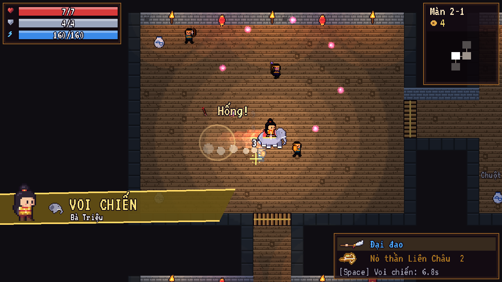 |
| **Hịch Tướng Sĩ** *(Trần Hưng Đạo)* | **Thần Tốc** *(Quang Trung)* |
|  | 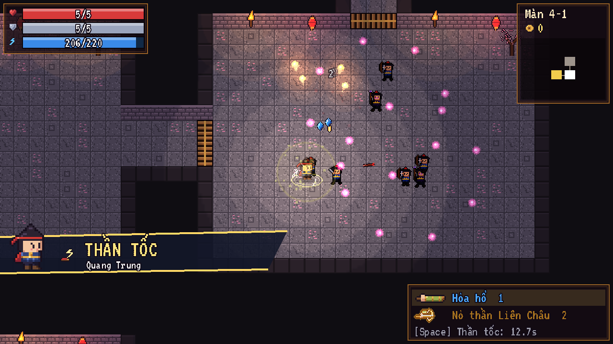 |

</div>

<details>
<summary>📖 <strong>Chi tiết Tu luyện Tướng (Cấp 1–5), Rèn Binh Khí Gốc (Bậc 1–5) & 6 Ấn Hệ Đồng Điệu</strong></summary>

#### 1. Tu luyện tướng & Rèn binh khí khởi đầu
Đứng cạnh tượng tướng trong Doanh trại (`E` → thẻ **Tu luyện**) để nâng cấp vĩnh viễn cho từng tướng:
- **Tu luyện tướng (Cấp 1 → 5)**: Cấp 2 `+1 máu` (`150 xu`), Cấp 3 `+1 giáp` (`300 xu`), Cấp 4 `+30 năng lượng` (`500 xu + 2 yeu_hon`), Cấp 5 `hồi kỹ năng ×0,85` (`800 xu + 1 ngoc_than`).
- **Rèn binh khí khởi đầu (Bậc 1 → 5)**:
  - Bậc 2 (`100 xu + 3 dong`): sát thương `×1,25`.
  - Bậc 3 (`220 xu + 5 sat + 2 dong`): sát thương `×1,5`, hồi đòn `×0,92`, mở **Đặc tính 1**.
  - Bậc 4 (`400 xu + 6 sat + 2 yeu_hon`): sát thương `×1,8`, hồi đòn `×0,88`.
  - Bậc 5 **Thức tỉnh** (`700 xu + 8 sat + 3 yeu_hon + 2 ngoc_than`): sát thương `×2,2`, hồi đòn `×0,85`, mở **Đặc tính 2**.

#### 2. Đồng điệu binh khí (★ / ★★) & 6 Ấn hệ khi tung chiêu
- **★★ Tâm đắc**: Cầm đúng vũ khí khởi đầu của tướng hoặc binh khí định mệnh → kỹ năng cường hóa tối đa + hiệu ứng phụ riêng.
- **★ Cùng hệ**: Cầm vũ khí cùng hệ hoặc **Thần khí** → tăng cường chiêu thức vừa phải.

| Hệ vũ khí | Ấn hệ | Hiệu ứng cộng thêm |
|---|---|---|
| Đao kiếm (`kiem`) | **Kiếm khí** | Phóng 6 sóng kiếm tỏa 360° theo sát thương vũ khí đang cầm |
| Côn thương (`truong`) | **Trấn địa** | Sóng chấn địa bán kính 60, đẩy lùi mạnh và choáng `0,6s` |
| Cung nỏ (`cung_no`) | **Mưa tên** | Rơi 12 mũi tên đuổi quanh thân trong `1,5s` |
| Hỏa khí (`hoa_khi`) | **Hỏa ấn** | Tạo 3 vùng lửa hình tam giác thiêu đốt giặc |
| Súng (`sung`) | **Nạp đạn thần tốc** | Trong `4s`: tốc bắn `+30%`, đạn xuyên thêm 1 mục tiêu |
| Thần khí (`than_khi`) | **Linh khí** | Hồi `40` năng lượng và giảm `30%` hồi chiêu lần đó |

</details>

---

## 🗡️ 225 Binh Khí, Hợp Nhất & Thần Binh Đỏ

Hệ thống vũ khí chia làm **6 bậc hiển thị** bằng màu sắc & hào quang:
**Thường** *(xám)* → **Tốt** *(xanh lá)* → **Hiếm** *(xanh dương)* → **Sử thi** *(tím)* → **Huyền thoại** *(vàng cam)* → **Thần binh Đỏ (`#ff384c`, hào quang đỏ thẫm)** độc quyền rơi từ Trùm.

- **18 Công Thức Hợp Nhất (`Phím R`)**: Gồm 6 Thần Binh Hợp Nhất kinh điển (*Thái Cực Kiếm, Cung Lôi Hỏa, Pháo Thiên Long, Lưỡi Hái Âm Dương, Nỏ Thiên Cơ, Trượng Ngũ Hành*) cùng *Long Thần Hải Kích*, *Thiên Lôi Thần Cung* và 10 công thức nâng cấp khác.
- **Thần Binh Đỏ Của Trùm**: 10 Đại Trùm Lịch Sử + 3 Tam Yêu + Trùm Bí Cảnh & Màn 33 (*Đinh Ba Thủy Tinh Thần*, *Lôi Chùy Thiên Đế*, *Thái Tổ Thiên Kiếm*).
- **12 Bùa Vũ Khí & 8 Affix Ngẫu Nhiên**: *Tốc Xạ, Bạo Kích, Lôi Điện, Khổng Lồ, Tiết Khí, Cuồng Sát, Xuyên Thấu, Băng Hỏa*.

---

## 🏯 Doanh Trại, 15 Cổ Vật, Thần Thú & Thế Giới Trong Trận

<div align="center">

| Doanh Trại Thức Tỉnh Thần Thú & NPC Giải Cứu | Tầng Hầm Vinh Quang & Bàn Bản Vẽ |
| :---: | :---: |
| 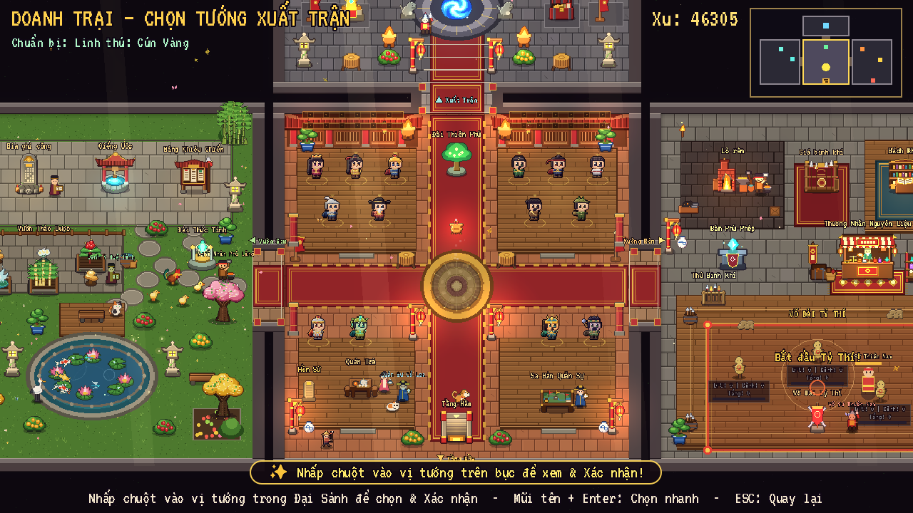 | 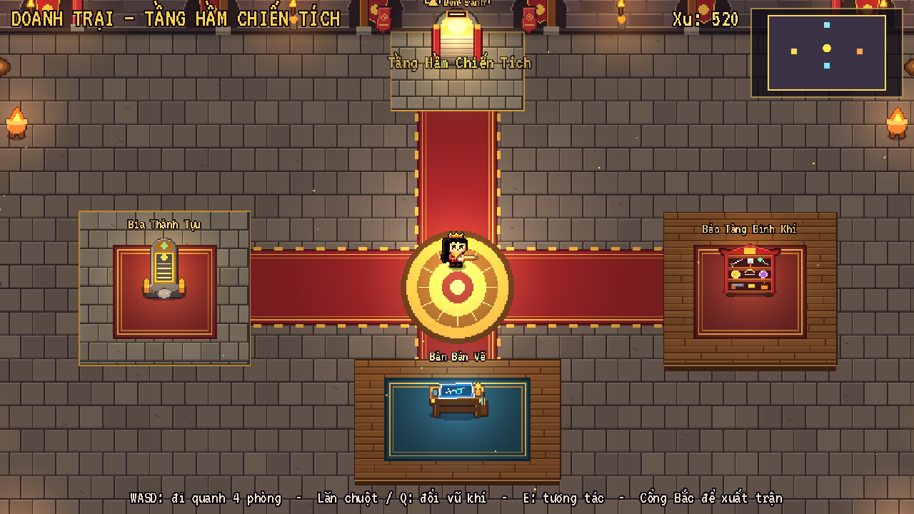 |

</div>

- **Doanh Trại Anh Hùng Liên Thông**: Đại Sảnh Tướng (chọn 14 Tướng, Chiêu 1/2, Skin, Tu luyện), Võ Đường (hình nhân đo DPS + Võ Đài Tỷ Thí), Khu Rèn & Quán Trà (Gieo Quẻ Đầu Làng), Vườn Thảo Dược **6 luống**, Đài Thức Tỉnh **4 Thần Thú**, **Cây Thiên Phú 16 nút** và Tầng Hầm Vinh Quang (**24 Hồn Sử**).
- **15 Cổ Vật Sử Việt**: Từ *Trống Đồng Ngọc Lũ*, *Móng Rùa Kim Quy*, *Ấn Đền Trần* đến *Ngọc Tỷ Đại Việt*, *Hạt Lúa Thần*... nhặt trong rương báu, sự kiện và Thủ Thành Cổ Loa.
- **6 Phòng Sự Kiện `[!]`, 3 Thú Cưỡi & 5 Tượng Thần Việt**: *Lò Rèn Cổ (Tiến Hóa)*, *Bệ Phân Tách*, *Miếu Thần Việt*, *Quân Sư Truyền Nghệ*, *Trại Quân Y*, *Đài Thách Đấu*; thú cưỡi *Voi Chiến, Ngựa Sắt, Xe Tăng Chiến*.
- **10 Chương Lịch Sử + 2 Bí Cảnh + Kết Thúc Thực Màn 33**: 4 cơ chế địa hình chiến trường, thời tiết riêng từng chương và Trùm 48 khung hình chuyển động + Hiện Nguyên Hình Pha 2 & Pha 3 Hào Khí.

<div align="center">

| Bộ Trùm 48 Khung Chuyển Động | Hiện Nguyên Hình Ma Tướng | Tam Yêu Truyền Thuyết |
| :---: | :---: | :---: |
| 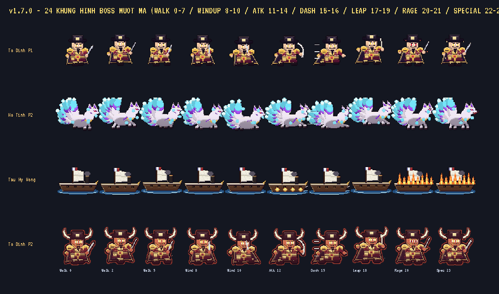 | 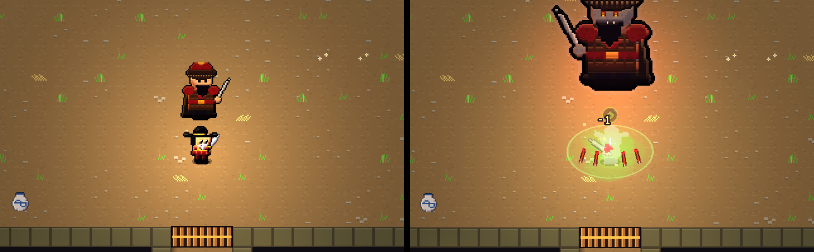 | 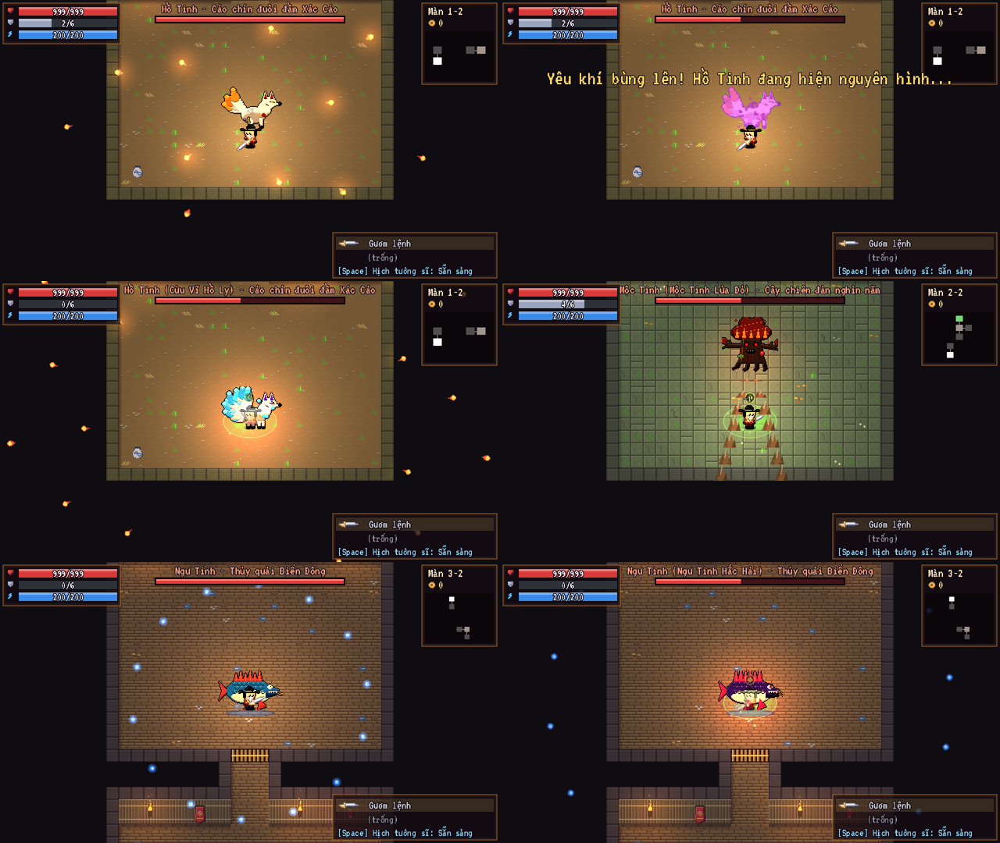 |

</div>

---

## 🏆 Chế Độ Chơi & Thử Thách

- **Thủ Thành Cổ Loa (`CoLoaDefense`)**: Xây & nâng cấp 5 loại tháp 3 bậc bảo vệ Lõi Nỏ Thần qua từng đợt công thành.
- **Hào Khí Bậc 1..10 & Ác Mộng**: Leo 10 bậc độ khó, mở khóa Boss Pha 3 và tăng phần thưởng mảnh bản vẽ / cổ vật.
- **Boss Rush (12 Trùm Liên Hoàn)** → Sảnh Chiến Thần tầng 13.
- **Thử Thách Hôm Nay (`NGAY-YYYYMMDD`)**, **LAN Co-op** (cộng hưởng Hợp Chiêu & Ping chiến thuật) và **8 Biến Số Chiến Trường (`Mutators`)**.

---

## 🎨 Pixel Art, Âm Nhạc & Dành Cho Nhà Phát Triển

Bộ asset trong game được sinh tự động bằng Python (`tools/sprites/` và `tools/audio/`), giữ phong cách đồng nhất và dễ mở rộng. Xem 5 trang sách tranh tại `docs/artbook/`:
- [`1-tuong.png`](docs/artbook/1-tuong.png) • [`2-quan-dich.png`](docs/artbook/2-quan-dich.png) • [`3-trum.png`](docs/artbook/3-trum.png) • [`4-vu-khi.png`](docs/artbook/4-vu-khi.png) • [`5-hieu-ung.png`](docs/artbook/5-hieu-ung.png)

<details>
<summary>🛠️ <strong>Hướng dẫn mở bằng Godot 4.7.2, Build Sprite/Audio, Cấu trúc Dự án & Kiểm Thử</strong></summary>

#### 1. Chạy từ mã nguồn
1. Cài **Godot 4.7.2** (bản Standard) từ [godotengine.org](https://godotengine.org/).
2. Mở Godot → **Import** → chọn `project.godot` → bấm **F5**.

#### 2. Sinh lại Pixel Art, Artbook & Âm Thanh 44.1 kHz
```bash
pip install pillow
python3 tools/sprites/build_all.py
python3 tools/sprites/artbook.py
python3 tools/audio/build_audio.py
```

#### 3. Kiểm thử tự động
```bash
# Kiểm tra cú pháp toàn bộ script
godot --headless --path . res://tests/check_scripts.tscn --quit

# Kiểm thử tổng lực v3.0.0 (Cổ Loa, 14 Tướng, Skins, Cổ Vật, Thiên Phú, Bí Cảnh, Hào Khí, Màn 33)
godot --headless --path . res://tests/v30_mega_expansion_test.tscn

# Kiểm thử hệ thống âm thanh 44.1 kHz Stereo (19 nhạc, 90 SFX)
godot --headless --path . res://tests/audio_test.tscn
godot --headless --path . res://tests/v15_dynamic_bgm_test.tscn

# Kiểm thử luồng chơi dài (14 tướng, 31 màn, Tam Yêu, Hiện nguyên hình)
godot --headless --path . res://tests/smoke_test.tscn
```

#### 4. Cấu trúc thư mục chính
```text
assets/
  sprites/             Toàn bộ đồ họa pixel (PNG) & grips.json
  audio/               19 nhạc nền stereo 44.1kHz (.wav) & 90 SFX 44.1kHz (.wav)
  fonts/               Font VT323 hỗ trợ đầy đủ tiếng Việt (OFL)
tools/
  sprites/             Công cụ Python sinh đồ họa (art_coloa, art_v30, art_heroes, artbook...)
  audio/               build_audio.py (bộ tổng hợp ngũ cung 44.1kHz stereo + reverb)
scenes/                Các màn hình & thực thể (.tscn)
scripts/
  autoload/            Global, Updater (Hotpatch), HotpatchSync
  audio/               sfx.gd (autoload Sfx: 19 nhạc, 90 SFX, crossfade 2 kênh)
  net/                 Net (LAN), discovery, net_sync
  data/                heroes, hero_skills_ext, weapons, relics, skill_tree, co_loa_data, hao_khi_data...
  entities/            player, enemy, bullet, defense_tower, co_loa_core, rescue_npc, sparring_arena...
  effects/             fx, skill_fx, weather_fx, ground_decal, coop_combo_fx, ping_marker...
  game/                game, co_loa_defense, dungeon, room, lobby, shop...
  ui/                  main_menu, lobby_ui, hud, match_summary, challenge_menu, pause_menu...
tests/                 35 bộ kiểm thử tự động & hồi quy
```

</details>

---

## 🕊️ Lưu Ý Nội Dung Lịch Sử & Ghi Công

- Các danh tướng Việt Nam được khắc họa theo phong cách chibi trang trọng, tôn vinh tinh thần giữ nước qua các thời đại.
- Địch thủ đại diện cho các đạo quân xâm lược thời phong kiến & thực dân gắn với diễn biến lịch sử, kết hợp yếu tố yêu quái dân gian nhằm tăng tính giả tưởng trò chơi, không nhằm chế giễu bất kỳ dân tộc nào.
- Xem chi tiết nguồn cảm hứng, font chữ và công cụ sử dụng tại [**CREDITS.md**](CREDITS.md).
